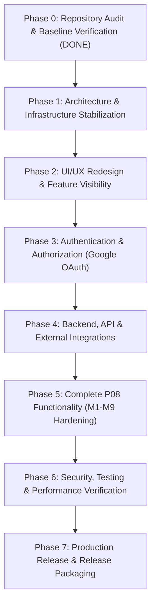

# Scholar Lens — Master Implementation Plan (Phases 1–7)

**Document Version:** 1.0.0  
**Date:** November 6, 2026  
**Architect:** Principal Software Architect & Engineering Lead  
**Objective:** Transform Scholar Lens into an Institution-Ready, Fully Functional, Secure, Polished, and Demonstrably P08-Compliant Platform  

---

## 1. Roadmap & Phase Execution Protocol

The master execution follows a strict phase-gated methodology:

Every phase has:
- Explicit tasks and files to modify/create.
- Verification gates (automated tests, Django checks, regression verification).
- Zero destruction of existing features (AI engine, evaluation, research tools, P08 modules).

---

## 2. Phase 1 — Architecture & Infrastructure Stabilization

### Objectives:
1. Ensure Django settings cleanly handle development, testing, and production environments without manual hacks.
2. Inject explicit role variables (`is_dean`, `is_office`) into global template context via context processor.
3. Validate database connection pooling, PostgreSQL 16 support, and migration integrity.
4. Establish clean error handling, logging, and static/media configurations.

### Action Steps:
- [ ] **Step 1.1:** Update `scholar_lens/context_processors.py` to import and inject `is_dean` and `is_office` using `dashboard.permissions`.
- [ ] **Step 1.2:** Hardening settings in `scholar_lens/settings.py` for database URL handling, logging, SSL proxy headers, and secret management.
- [ ] **Step 1.3:** Verify static files collection (`python manage.py collectstatic --noinput`) and media root creation.
- [ ] **Step 1.4:** Run Django system checks and verify migration consistency.

### Acceptance Criteria:
- `python manage.py check` reports 0 issues.
- `is_dean` and `is_office` are universally available in all Django templates.
- Migrations apply consistently on PostgreSQL without errors.

---

## 3. Phase 2 — UI/UX Redesign & Feature Visibility

### Objectives:
1. Eliminate the design system conflict: replace neo-brutalist 3.5px black borders, pastel boxes, and hard offset drop shadows with the official LPU institutional design tokens.
2. Consolidate design tokens into `static/css/institutional_tokens.css` and modernize `static/css/style.css` and `static/css/ums.css`.
3. Standardize the application layout shell: header, announcement strip, sidebar navigation, main container, breadcrumbs, and footer.
4. Fix responsive viewport behavior across all breakpoints (1440px desktop down to 360px mobile).
5. Ensure all intended features are visible to authorized users without fragile username checks.

### Action Steps:
- [ ] **Step 2.1:** Create `static/css/institutional_tokens.css` defining the canonical LPU institutional design tokens:
  - Primary Maroon: `#9B2335`
  - Dark Maroon: `#7A1B29`
  - Maroon Tint: `#FBEFF1`
  - Primary Action Orange: `#F37021`
  - Orange Hover: `#E0601A`
  - Page Background: `#F5F5F7`
  - Card Background: `#FFFFFF`
  - Neutral Border: `#E2E4E8`
  - Text Primary: `#1F2328`
  - Text Muted: `#5B6270`
- [ ] **Step 2.2:** Refactor `static/css/style.css` to remove brutalist black borders (`3.5px solid var(--ink-black)`), replace offset black shadows with soft institutional elevations (`0 1px 3px rgba(0,0,0,0.06)`), and remove legacy pink/cyan classes.
- [ ] **Step 2.3:** Harmonize `static/css/ums.css` to work seamlessly with the token system.
- [ ] **Step 2.4:** Update `templates/base.html`:
  - Link `institutional_tokens.css`.
  - Fix sidebar navigation: use `` for Reports.
  - Expand touch targets to $\ge 44\text{px}$.
  - Improve header search input responsiveness.
- [ ] **Step 2.5:** Redesign Dashboard (`templates/dashboard/home.html`):
  - Replace `.module-showcase-box` with institutional showcase card.
  - Clean up `.metric-strip-item` cards with white backgrounds, maroon accents, and clean typography.
  - Fix quick action cards and mobile grid wrapping.
- [ ] **Step 2.6:** Inspect and adjust all core module templates (`papers`, `researchers`, `projects`, `opportunities`, `facilities`, `funding`, `analytics`, `office`, `ai_engine`, `evaluation`).

### Acceptance Criteria:
- No visual neo-brutalist black borders or offset black shadows remaining.
- Consistent maroon and orange institutional palette across all views.
- Zero horizontal overflow on mobile viewports (tested at 360px, 375px, 390px, 768px, 1024px, 1280px, 1440px).
- Navigation cleanly displays permitted links for Researcher, Faculty, Staff, and Dean.

---

## 4. Phase 3 — Authentication & Authorization (Google OAuth)

### Objectives:
1. Ensure Google OAuth 2.0 / OpenID Connect is fully functional and production-ready.
2. Verify authorization code exchange, state token CSRF validation, and ID token claims verification (`iss`, `aud`, `exp`, `email_verified`).
3. Ensure account provisioning and account linking via Google `sub` work cleanly.
4. Verify standard username/password authentication, registration, password change, and session logout.
5. Secure role-based authorization in backend views.

### Action Steps:
- [ ] **Step 3.1:** Review and harden `accounts/google_auth.py`:
  - Ensure dynamic redirect URI handles HTTPS and reverse proxies cleanly.
  - Validate Google audience and issuer strictly.
  - Ensure email is verified before account creation or linking.
- [ ] **Step 3.2:** Verify mock authentication in `accounts/views.py` (`google_mock_view`) is strictly gated to `settings.DEBUG=True` and disabled in production.
- [ ] **Step 3.3:** Harden login, register, and profile templates with institutional design tokens.
- [ ] **Step 3.4:** Execute authentication test suite (`tests/test_google_auth.py`, `tests/test_scholar_lens.py::AuthenticationTestCase`).

### Acceptance Criteria:
- Google OAuth flow passes state verification, code exchange, and token claims validation.
- Unauthorized access to protected endpoints redirects to login or returns `401 JSON`.
- Role-based permissions enforced on Research Office, Dean of Research, Custodians, and Project Leaders.

---

## 5. Phase 4 — Backend, API & External Integrations

### Objectives:
1. Provide a lightweight institutional JavaScript API client (`static/js/api_client.js`) to consume the 9 P08 JSON APIs.
2. Integrate frontend interfaces with actual backend endpoints for fast asynchronous filtering, search hints, and status updates.
3. Harden all external integrations (ORCID, Crossref, Scopus, SerpAPI, iCalendar, OpenAI).
4. Verify graceful fallbacks when optional credentials (OpenAI, Scopus, SerpAPI) are not provided.

### Action Steps:
- [ ] **Step 4.1:** Create `static/js/api_client.js` with standardized methods:
  - `api.researchers.list({ department, limit })`
  - `api.search.expertise({ q, department, limit })`
  - `api.publications.list({ year, limit })`
  - `api.openings.list({ limit })`
  - `api.projects.list({ limit })`
  - `api.facilities.list({ limit })`
  - `api.bookings.list({ limit })`
  - `api.fundingCalls.list({ open, limit })`
  - `api.analytics.research({ year })`
- [ ] **Step 4.2:** Integrate search suggestions and live filtering on Researcher and Paper lists.
- [ ] **Step 4.3:** Verify ORCID and Crossref ingestion resilience (`papers/importers.py`).
- [ ] **Step 4.4:** Verify Scopus licence handling and error transparency.
- [ ] **Step 4.5:** Verify iCalendar RFC 5545 `.ics` export on facilities bookings.
- [ ] **Step 4.6:** Verify OpenAI AI summarization, research gap detection, and RAG Ask Your Paper fallbacks.

### Acceptance Criteria:
- All 9 P08 APIs consumed or consumable via unified client.
- External import batches handle malformed inputs gracefully.
- AI services present informative badges when API keys are absent without throwing unhandled exceptions.

---

## 6. Phase 5 — Complete P08 Functionality (M1–M9 Hardening)

### Objectives:
Systematically harden and verify every module workflow end-to-end:
- **M1:** Researcher directory, taxonomy selector, ORCID checksum, verification workflow, audit trail.
- **M2:** Publication catalog, multi-tier deduplication ($\ge 95\%$ accuracy), review queue, reversible soft-merge, author disambiguation.
- **M3:** Weighted expertise search, faceted filters, sub-second latency across 2,000 profiles.
- **M4:** Research openings board, PDF application upload ($\le 5\text{MB}$), review queue, automatic project enrollment.
- **M5:** Algorithmic collaboration matching, rationale explanations, requests, Cytoscape.js network graph, accessible table.
- **M6:** Facilities catalogue, operating hours check, PostgreSQL `ExclusionConstraint` concurrency protection, custodian workflow, `.ics` calendar export, utilization charts.
- **M7:** Funding call register, countdown badges, automated deadline alert delivery (14, 7, 1 days), proposal tracking.
- **M8:** Project portfolio, milestone tracking, DFS dependency cycle check, pure CSS/SVG Gantt chart, scheduled risk detection, at-risk board.
- **M9:** Research Office command center, July 1–June 30 academic-year reporting, Dean confidential privacy isolation, immutable audit logging, CSV export.

### Action Steps:
- [ ] **Step 5.1:** Audit and verify M1 workflows and templates.
- [ ] **Step 5.2:** Audit and verify M2 deduplication and author disambiguation queues.
- [ ] **Step 5.3:** Audit and verify M3 expertise search performance.
- [ ] **Step 5.4:** Audit and verify M4 openings and application review.
- [ ] **Step 5.5:** Audit and verify M5 collaboration suggestions and Cytoscape graph.
- [ ] **Step 5.6:** Audit and verify M6 facility booking concurrency on PostgreSQL.
- [ ] **Step 5.7:** Audit and verify M7 funding calls and automated alerts command.
- [ ] **Step 5.8:** Audit and verify M8 project milestones, DFS validation, and Gantt charts.
- [ ] **Step 5.9:** Audit and verify M9 academic-year analytics and Dean confidentiality.

### Acceptance Criteria:
- End-to-end workflows for all 9 modules operate without errors.
- All 252 unit and integration tests pass.
- Compliance matrix updated to FULLY VERIFIED.

---

## 7. Phase 6 — Security, Testing & Performance Verification

### Objectives:
1. Conduct comprehensive security testing (CSRF, XSS, SQL injection, permission gating, upload validation).
2. Demonstrate acceptance targets:
   - Deduplication accuracy $\ge 95\%$ (Benchmark test).
   - Expertise search $< 1.0\text{s}$ over 2,000 profiles (Benchmark test).
   - Facility booking overlap prevention under concurrent load.
   - Dean privacy restriction verification.
3. Validate Cypress E2E test suites.
4. Execute accessibility audit (WCAG 2.1 AA).

### Action Steps:
- [ ] **Step 6.1:** Run dedicated security tests (`tests/test_advanced_hardening.py`).
- [ ] **Step 6.2:** Re-run deduplication benchmark test (`tests/test_dedup.py`).
- [ ] **Step 6.3:** Re-run expertise search performance benchmark (`tests/test_expertise_search.py`).
- [ ] **Step 6.4:** Re-run facility booking concurrency test (`tests/test_facilities.py`).
- [ ] **Step 6.5:** Verify Cypress E2E test suite setup and execution.
- [ ] **Step 6.6:** Verify color contrast and keyboard accessibility.

### Acceptance Criteria:
- Zero security vulnerabilities.
- Deduplication benchmark passes $\ge 95\%$.
- Search benchmark executes in $< 1.0\text{s}$.
- Test report documented in `docs/testing/TEST_RESULTS.md`.

---

## 8. Phase 7 — Production Release & Release Packaging

### Objectives:
1. Prepare production configuration: environment variables, security headers, database backup procedures, and deployment verification.
2. Clean repository of unnecessary development artifacts while preserving all project source files, fixtures, tests, and documentation.
3. Update all documentation (`README.md`, `PRODUCTION_READINESS.md`).
4. Document rollback and disaster recovery procedures.

### Action Steps:
- [ ] **Step 7.1:** Review `.env.example` ensuring all required and optional configuration keys are clearly documented.
- [ ] **Step 7.2:** Verify static files collection (`collectstatic`) and WhiteNoise configuration.
- [ ] **Step 7.3:** Verify Docker and Docker Compose configurations (`Dockerfile`, `docker-compose.yml`).
- [ ] **Step 7.4:** Clean up temporary artifacts, verify `.gitignore`.
- [ ] **Step 7.5:** Write comprehensive `docs/release/PRODUCTION_READINESS.md` and update `README.md`.

### Acceptance Criteria:
- Production checklist 100% satisfied.
- Clean working directory with no exposed secrets.
- Final engineering report delivered.
