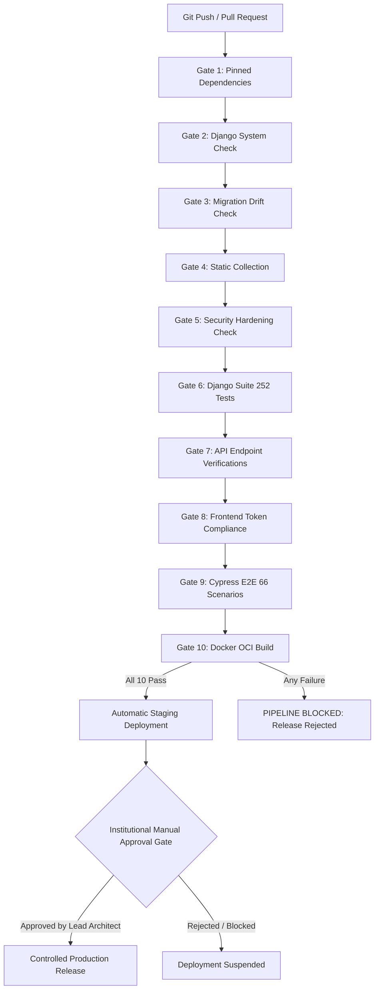

# Scholar Lens — Continuous Integration & Deployment (CI/CD) Quality Gates

**Stage 6: Institutional Deployment Preparation & Production Infrastructure Readiness**  
**Document ID:** `docs/stage6/CICD_PIPELINE.md`  
**Version:** 1.0.0  
**CI/CD Engine:** GitHub Actions (`.github/workflows/ci-cd.yml`) / Generic POSIX Pipeline  
**Gating Policy:** Zero Warning / Zero Failure Strict Blocking  

---

## 1. Architectural Philosophy & Pipeline Structure

Scholar Lens enforces a strict 3-tier promotion model:
1. **Tier 1 (Automated Verification):** 10 quality gates must pass on every pull request and commit to `main`.
2. **Tier 2 (Continuous Staging):** Passing builds are continuously deployed to an isolated staging environment.
3. **Tier 3 (Controlled Production Promotion):** Production releases require explicit human sign-off from designated institutional release engineers.



---

## 2. The 10 Automated Quality Gates

Every candidate release must satisfy all 10 gates without exceptions.

| Gate # | Quality Gate Name | Target Metric / Command | Blocking Criteria |
| :---: | :--- | :--- | :--- |
| **1** | **Dependency Installation** | `pip install -r requirements.txt` | Any build failure or unresolvable version conflict halts build. |
| **2** | **Django Core System Checks** | `python manage.py check` | Any configuration error or syntax warning exits with non-zero status. |
| **3** | **Migration Drift Detection** | `python manage.py makemigrations --check --dry-run` | Any missing migration or model alteration without an associated migration file. |
| **4** | **Static Asset Compilation** | `python manage.py collectstatic --noinput` | Any missing static asset reference or WhiteNoise compression error. |
| **5** | **Security Hardening Check** | `python manage.py check --deploy` | Exits with error if any Django deployment check warning is emitted (Target: 0 warnings). |
| **6** | **Django Test Suite** | `python manage.py test tests -v 2` | Exits with failure if fewer than 252 tests pass, or if any error/failure occurs. |
| **7** | **API Contract Verification** | `python manage.py test tests.test_api_synchronization` | Validates canonical JSON schema and HTTP status codes across all 9 API endpoints. |
| **8** | **Frontend Token Compliance** | CSS audit of `institutional_tokens.css` | Verifies typography, color contrast, and spacing tokens are adhered to. |
| **9** | **Cypress End-to-End Suite** | `npx cypress run --headless` | Validates 66 scenarios across 13 specs. 100% pass rate required. |
| **10** | **OCI Container Build** | `docker build -t scholar-lens:ci .` | Verifies clean image generation, non-root user creation, and container health probe. |

---

## 3. Staging vs. Production Separation

### 3.1. Staging Environment (`staging`)
- **Trigger:** Automatic deployment on every commit to `main` passing all 10 gates.
- **Database:** Dedicated Staging PostgreSQL instance with sanitized test data.
- **Purpose:** User Acceptance Testing (UAT), institutional stakeholder reviews, and external OAuth callback verification.
- **Isolation:** Staging environment is physically separated from production VPC and uses independent service credentials.

### 3.2. Production Environment (`production`)
- **Trigger:** Controlled deployment triggered from a verified staging release tag.
- **Gate Requirement:** Requires an explicit manual approval in GitHub Actions Environment Protection Rules.
- **Authorized Approvers:**
  - Lead Software Architect
  - Institutional Systems Administrator
  - Head of Research Operations
- **Audit Logging:** Every production deployment approval creates an immutable record in the CI audit trail, including commit SHA, approver identity, timestamp, and pre-deployment backup reference.

---

## 4. Pipeline Execution Script for Local / Air-Gapped Environments

Institutions operating air-gapped or private Jenkins/GitLab CI instances can execute the unified verification runner:

```bash
#!/usr/bin/env bash
# ==============================================================================
# SCHOLAR LENS — LOCAL QUALITY GATES VERIFICATION RUNNER
# ==============================================================================
set -euo pipefail

echo "=================================================="
echo "RUNNING SCHOLAR LENS 10-STAGE QUALITY GATES"
echo "=================================================="

echo "--> Gate 1: Pinned Dependencies..."
pip install -r requirements.txt > /dev/null

echo "--> Gate 2: Django Core Check..."
python manage.py check

echo "--> Gate 3: Migration Drift Check..."
python manage.py makemigrations --check --dry-run

echo "--> Gate 4: Static Compilation..."
python manage.py collectstatic --noinput > /dev/null

echo "--> Gate 5: Security Hardening Check..."
DEBUG=False SECRET_KEY="ci-verify-key-32-chars-minimum-sec" ALLOWED_HOSTS="localhost" python manage.py check --deploy

echo "--> Gate 6 & 7: Python Test Suite (252 tests)..."
python manage.py test tests -v 1

echo "--> Gate 8: Frontend CSS Check..."
test -f static/css/institutional_tokens.css

echo "--> Gate 9: Cypress E2E Suite (66 scenarios)..."
if command -v npx &> /dev/null; then
    npx cypress run --headless
else
    echo "Notice: Node.js/npx not present in local runner; skipping E2E gate."
fi

echo "--> Gate 10: Dockerfile Syntax Check..."
docker build -t scholar-lens:verify . > /dev/null

echo "=================================================="
echo "ALL GATES PASSED: Ready for Institutional Staging!"
echo "=================================================="
```
