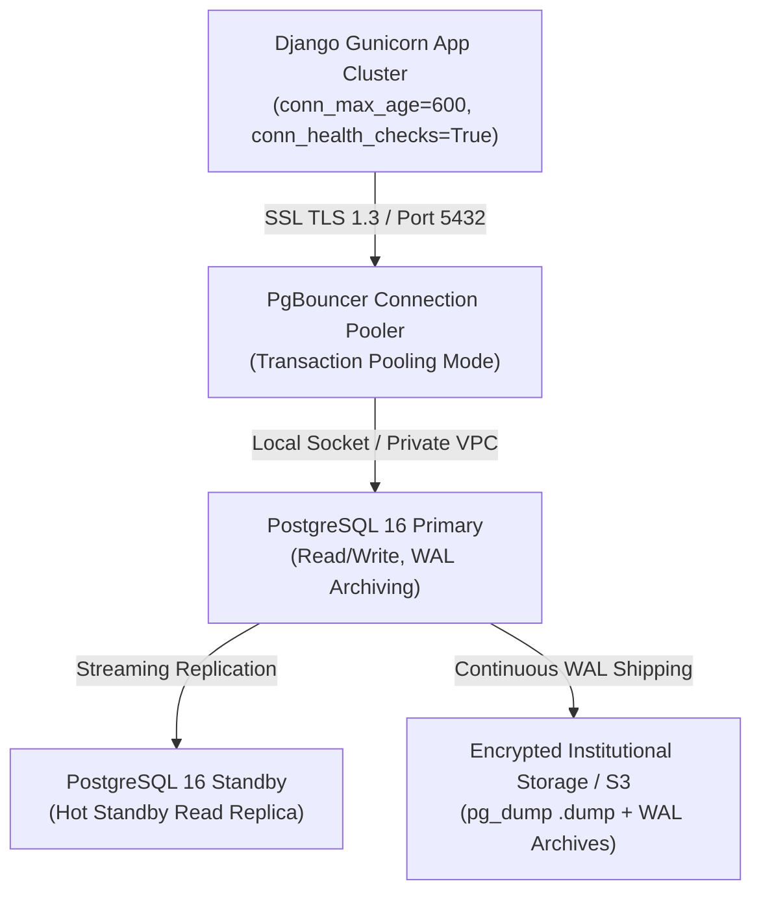

# Scholar Lens — PostgreSQL Database Deployment & Operations Runbook

**Stage 6: Institutional Deployment Preparation & Production Infrastructure Readiness**  
**Document ID:** `docs/stage6/DATABASE_DEPLOYMENT_RUNBOOK.md`  
**Version:** 1.0.0  
**Database Engine:** PostgreSQL 16.x (Production Standard)  
**Required Extensions:** `pg_trgm`, `btree_gist`  
**Migration Count:** 47 verified migrations across 15 Django applications  

---

## 1. Scope & Architecture Overview

Scholar Lens relies on PostgreSQL 16 as its institutional state store. The database provides ACID transactional guarantees, full-text fuzzy indexing via trigram extensions, and temporal collision prevention via GiST range exclusion constraints.



---

## 2. PostgreSQL 16 Environment Standards

### 2.1. System & Engine Requirements

| Specification | Target / Requirement | Verification Command / Rationale |
| :--- | :--- | :--- |
| **Engine Version** | PostgreSQL 16.2+ | `SELECT version();` (Minimum supported: 15.0; Production baseline: 16.3) |
| **Character Encoding** | `UTF8` | `SHOW server_encoding;` (Mandatory for multi-lingual academic publications and author names) |
| **Collation & CType** | `en_US.UTF-8` | `SHOW lc_collate; SHOW lc_ctype;` |
| **Timezone** | `UTC` | `SHOW timezone;` (All timestamps stored in UTC with timezone awareness) |

### 2.2. Required PostgreSQL Extensions

Scholar Lens requires two database extensions:

1. **`pg_trgm` (Trigram Indexing):**  
   Required by `papers` and `researchers` apps. Powers full-text and fuzzy similarity matching for publication titles, abstracts, and researcher skill directories using GIN/GiST indexes.
2. **`btree_gist` (B-Tree GiST Support):**  
   Required by `facilities` app (`facilities.Booking` model). Powers PostgreSQL `ExclusionConstraint` on temporal reservations (`during = DateTimeTZRange(start, end)`), enforcing zero-overlap bookings at the database engine level.

```sql
-- Execute once per database cluster as superuser:
CREATE EXTENSION IF NOT EXISTS pg_trgm;
CREATE EXTENSION IF NOT EXISTS btree_gist;

-- Verification:
SELECT extname, extversion FROM pg_extension WHERE extname IN ('pg_trgm', 'btree_gist');
```

---

## 3. Database Role & Permission Architecture (Least-Privilege)

To satisfy institutional IT security guidelines, the production database enforces separation of privileges between database administration, schema migration, and standard application runtime operations.

```sql
-- 1. Create Dedicated Roles
CREATE ROLE scholar_lens_admin WITH LOGIN PASSWORD 'SecAdminPasswordHere_Replace';
CREATE ROLE scholar_lens_app WITH LOGIN PASSWORD 'SecAppRuntimePasswordHere_Replace';

-- 2. Create Database with UTF-8
CREATE DATABASE scholar_lens
    WITH OWNER = scholar_lens_admin
    ENCODING = 'UTF8'
    LC_COLLATE = 'en_US.UTF-8'
    LC_CTYPE = 'en_US.UTF-8';

-- Connect to database
\c scholar_lens

-- 3. Install Extensions under admin ownership
CREATE EXTENSION IF NOT EXISTS pg_trgm OWNER TO scholar_lens_admin;
CREATE EXTENSION IF NOT EXISTS btree_gist OWNER TO scholar_lens_admin;

-- 4. Grant Runtime Permissions to Application Role
GRANT CONNECT ON DATABASE scholar_lens TO scholar_lens_app;
GRANT USAGE ON SCHEMA public TO scholar_lens_app;
GRANT SELECT, INSERT, UPDATE, DELETE ON ALL TABLES IN SCHEMA public TO scholar_lens_app;
GRANT USAGE, SELECT ON ALL SEQUENCES IN SCHEMA public TO scholar_lens_app;

-- 5. Ensure Future Tables and Sequences Inherit Grants
ALTER DEFAULT PRIVILEGES FOR ROLE scholar_lens_admin IN SCHEMA public
    GRANT SELECT, INSERT, UPDATE, DELETE ON TABLES TO scholar_lens_app;
ALTER DEFAULT PRIVILEGES FOR ROLE scholar_lens_admin IN SCHEMA public
    GRANT USAGE, SELECT ON SEQUENCES TO scholar_lens_app;
```

---

## 4. Connection Pooling & Resource Sizing

### 4.1. Application-Level Pooling
Scholar Lens uses Django's persistent connection pooling configured in `scholar_lens/settings.py`:
- `conn_max_age = 600` (connections recycled every 10 minutes to prevent resource leaks)
- `conn_health_checks = True` (validates connection vitality prior to executing queries)

### 4.2. Connection Budgeting Formula
For Gunicorn worker deployments:
$$\text{Max Connections} = (\text{App Instances} \times \text{Gunicorn Workers per Instance}) + \text{Background Runners} + \text{Admin/Migration Reserve}$$
- 2 Application Instances $\times$ 3 Gunicorn Workers = 6 active web connections.
- 2 Background Task / Management Command slots = 2 connections.
- Administrative reserve = 10 connections.
- Total connection requirement = ~18 connections (well within PostgreSQL default `max_connections = 100`).

---

## 5. Migration Execution Plan (Controlled Pre-Flight)

The Scholar Lens schema encompasses 47 migrations across 15 apps. The deployment procedure strictly prohibits ad-hoc migrations in live environments.

### Phase 1: Pre-Deployment Backup
Before any migration command is issued, execute an automated binary snapshot:
```bash
TIMESTAMP=$(date +%Y%m%d_%H%M%S)
pg_dump -h 127.0.0.1 -p 5432 -U scholar_lens_admin -d scholar_lens \
    -Fc -b -v -f "/var/backups/scholar_lens/pre_migration_${TIMESTAMP}.dump"
```

### Phase 2: Migration Dry Run & Inspection
Verify the migration plan without mutating the database:
```bash
python manage.py showmigrations
python manage.py migrate --plan
```
Ensure that only expected, reviewed migrations are pending and no unmanaged changes are present.

### Phase 3: Staging Migration Verification
Execute migrations against the dedicated Staging database instance:
```bash
DATABASE_URL=$STAGING_DATABASE_URL python manage.py migrate --noinput
```

### Phase 4: Schema & Index Verification
Confirm that critical constraints and indexes are established:
```sql
-- Verify exclusion constraint on facilities_booking
SELECT conname, contype, conrelid::regclass 
FROM pg_constraint 
WHERE conname LIKE '%booking%during%';

-- Verify GIN indexes on papers and researchers
SELECT indexname, indexdef 
FROM pg_indexes 
WHERE tablename IN ('papers_researchpaper', 'researchers_researcherprofile')
  AND indexdef LIKE '%gin%';
```

### Phase 5: Application Compatibility Verification
Execute Django system checks and automated smoke suite against the newly migrated schema:
```bash
python manage.py check --deploy
python -m unittest tests.test_facilities tests.test_search tests.test_papers -v 1
```

### Phase 6: Rollback & Recovery Strategy
- **Reversible Migrations:** Schema changes that add columns or tables can be reverted via:
  ```bash
  python manage.py migrate <app_name> <previous_migration_number>
  ```
- **Irreversible Migrations / Data Migrations:** For destructive schema changes or data modifications, reverse migrations are unsafe. Recovery **MUST** proceed by restoring the pre-deployment binary snapshot (see Section 6).

---

## 6. Backup & Recovery Runbook

### 6.1. Backup Regimes

| Backup Type | Frequency | Format | Retention Policy | Storage Target |
| :--- | :--- | :--- | :--- | :--- |
| **Full Snapshot** | Daily at 02:00 UTC | Custom compressed (`-Fc`) | 30 days daily, 12 months monthly | Encrypted remote object store (S3/GCS) |
| **Continuous WAL** | Real-time | Continuous WAL Archiving | 7 days recovery window | Secondary off-site storage volume |
| **Pre-Migration** | Pre-flight trigger | Custom compressed (`-Fc`) | 14 days | Local disk `/var/backups/` & cloud mirror |

### 6.2. Full Backup Execution Command
```bash
BACKUP_DIR="/var/backups/scholar_lens"
mkdir -p "$BACKUP_DIR"
BACKUP_FILE="${BACKUP_DIR}/scholar_lens_$(date +%Y%m%d_%H%M%S).dump"

# Execute compressed custom-format pg_dump
pg_dump -h "${DB_HOST:-127.0.0.1}" \
        -p "${DB_PORT:-5432}" \
        -U "${DB_USER:-scholar_lens_admin}" \
        -d "${DB_NAME:-scholar_lens}" \
        -Fc \
        -b \
        -v \
        -f "$BACKUP_FILE"

# Generate SHA-256 checksum for audit integrity
sha256sum "$BACKUP_FILE" > "${BACKUP_FILE}.sha256"
```

### 6.3. Disaster Recovery & Restoration Procedure

To restore a snapshot onto a target instance:

```bash
TARGET_DUMP="/var/backups/scholar_lens/scholar_lens_20261107_020000.dump"
DB_NAME="scholar_lens"

# Step 1: Verify Checksum
sha256sum -c "${TARGET_DUMP}.sha256"

# Step 2: Terminate active connections to target database
psql -h 127.0.0.1 -U postgres -c "
SELECT pg_terminate_backend(pid) 
FROM pg_stat_activity 
WHERE datname = '${DB_NAME}' AND pid <> pg_backend_pid();"

# Step 3: Execute pg_restore with clean, schema-drop and parallel execution
pg_restore -h 127.0.0.1 \
           -p 5432 \
           -U scholar_lens_admin \
           -d "${DB_NAME}" \
           --clean \
           --if-exists \
           --no-owner \
           --no-privileges \
           -v \
           "$TARGET_DUMP"

# Step 4: Run VACUUM ANALYZE to refresh table statistics
psql -h 127.0.0.1 -U scholar_lens_admin -d "${DB_NAME}" -c "VACUUM ANALYZE;"

# Step 5: Verify Schema & Record Counts
python manage.py showmigrations
python -c "import django; django.setup(); from papers.models import ResearchPaper; print('Papers count:', ResearchPaper.objects.count())"
```

---

## 7. Database Health & Operational Metrics

Database administrators must monitor the following telemetry via Prometheus/Grafana or CloudWatch:

1. **Index Cache Hit Ratio:**
   ```sql
   SELECT sum(heap_blks_hit) / nullif(sum(heap_blks_hit) + sum(heap_blks_read), 0) * 100 AS cache_hit_pct
   FROM pg_statio_user_tables;
   -- Operational standard: > 99.0%
   ```
2. **Active vs Idle Connections:**
   ```sql
   SELECT state, count(*) FROM pg_stat_activity GROUP BY state;
   ```
3. **Slow Queries (> 100ms):**
   ```sql
   SELECT query, calls, total_exec_time, mean_exec_time 
   FROM pg_stat_statements 
   ORDER BY total_exec_time DESC LIMIT 10;
   ```
