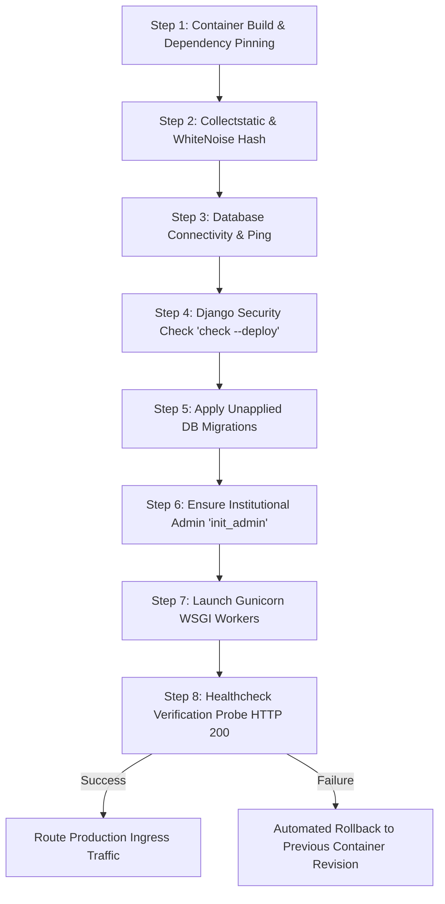

# Scholar Lens — Production Deployment Automation & Containerization

**Stage 6: Institutional Deployment Preparation & Production Infrastructure Readiness**  
**Document ID:** `docs/stage6/DEPLOYMENT_AUTOMATION.md`  
**Version:** 1.0.0  
**Container Standard:** OCI-Compliant Linux Containers (Python 3.11-slim)  
**Process Supervisor:** Gunicorn 26.2.0 with systemd or container orchestration  

---

## 1. Overview & Automation Philosophy

Scholar Lens deployment automation is designed around four principles:
1. **Reproducibility:** Hermetic, version-controlled builds where the exact same artifact is tested in CI, validated in Staging, and promoted to Production.
2. **Minimal Attack Surface:** Non-root execution (`appuser:appgroup`), no development tooling or test fixtures in production containers, strict `.dockerignore` enforcement.
3. **Zero In-Container Secrets:** Secrets are injected at runtime via environment variables or secret stores; no credentials exist in images.
4. **Resilient Startup & Healthchecks:** Pre-flight validation executes database checks, schema migration, and static asset verification before traffic is routed.

---

## 2. Containerization Architecture

### 2.1. Production Container Specification (`Dockerfile`)

The production container uses a security-hardened `python:3.11-slim` base image:

```dockerfile
FROM python:3.11-slim as base

ENV PYTHONDONTWRITEBYTECODE=1 \
    PYTHONUNBUFFERED=1 \
    PYTHONFAULTHANDLER=1 \
    PORT=8000

WORKDIR /app

# Install minimal OS runtime & compile dependencies
RUN apt-get update && apt-get install -y --no-install-recommends \
    gcc \
    libpq-dev \
    curl \
    && rm -rf /var/lib/apt/lists/*

# Install pinned Python dependencies
COPY requirements.txt .
RUN pip install --no-cache-dir --upgrade pip && \
    pip install --no-cache-dir -r requirements.txt

# Create unprivileged application user
RUN groupadd -g 10001 appgroup && \
    useradd -u 10001 -g appgroup -s /bin/bash -m appuser

# Copy application source
COPY . .

# Set appropriate directory ownership for assets and media
RUN mkdir -p /app/media /app/staticfiles && \
    chown -R appuser:appgroup /app

# Collect static assets into staticfiles
RUN python manage.py collectstatic --noinput 2>/dev/null || true

# Switch to non-root user
USER appuser

EXPOSE 8000

# Automated Liveness & Readiness Probe
HEALTHCHECK --interval=30s --timeout=5s --start-period=15s --retries=3 \
    CMD curl -f http://127.0.0.1:${PORT:-8000}/ || exit 1

# Launch Gunicorn with structured stdout logging
CMD ["sh", "-c", "python manage.py migrate --noinput && python manage.py init_admin && exec gunicorn scholar_lens.wsgi:application --bind 0.0.0.0:${PORT:-8000} --workers 3 --threads 2 --timeout 120 --access-logfile - --error-logfile -"]
```

### 2.2. Container Image Exclusions (`.dockerignore`)
To protect against sensitive leaks and bloat, `.dockerignore` filters out:
- Secrets (`.env`, `*.env`)
- Source control (`.git/`)
- Dev & E2E frameworks (`node_modules/`, `cypress/`)
- SQLite databases (`*.sqlite3`)
- Python caches (`__pycache__/`, `*.pyc`)

---

## 3. Deployment Lifecycle & Execution Pipeline

Every automated deployment follows a structured 8-step execution flow:



---

## 4. Bare-Metal & Virtual Machine Automation (Systemd Service)

For universities deploying on dedicated virtual machines (e.g. Ubuntu 22.04 / 24.04 LTS) rather than Docker:

### 4.1. Systemd Service Unit (`/etc/systemd/system/scholar-lens.service`)

```ini
[Unit]
Description=Scholar Lens Institutional Research Platform (Gunicorn WSGI)
After=network.target postgresql.service

[Service]
Type=notify
User=scholar_lens
Group=scholar_lens
WorkingDirectory=/var/www/scholar_lens
EnvironmentFile=/etc/scholar_lens/production.env
ExecStart=/var/www/scholar_lens/venv/bin/gunicorn scholar_lens.wsgi:application \
          --bind 127.0.0.1:8000 \
          --workers 3 \
          --threads 2 \
          --timeout 120 \
          --access-logfile /var/log/scholar_lens/access.log \
          --error-logfile /var/log/scholar_lens/error.log
ExecReload=/bin/kill -s HUP $MAINPID
KillMode=mixed
TimeoutStopSec=30
PrivateTmp=true
Restart=on-failure
RestartSec=5s

[Install]
WantedBy=multi-user.target
```

### 4.2. Zero-Downtime Deployment Shell Script (`deploy_production.sh`)

```bash
#!/usr/bin/env bash
# ==============================================================================
# SCHOLAR LENS — ZERO-DOWNTIME PRODUCTION DEPLOYMENT SCRIPT
# ==============================================================================
set -euo pipefail

DEPLOY_DIR="/var/www/scholar_lens"
VENV="${DEPLOY_DIR}/venv"
BACKUP_DIR="/var/backups/scholar_lens"

echo "==> [1/7] Navigating to deployment directory..."
cd "$DEPLOY_DIR"

echo "==> [2/7] Creating pre-deployment database snapshot..."
TIMESTAMP=$(date +%Y%m%d_%H%M%S)
mkdir -p "$BACKUP_DIR"
pg_dump -U scholar_lens_admin -d scholar_lens -Fc -f "${BACKUP_DIR}/pre_deploy_${TIMESTAMP}.dump"

echo "==> [3/7] Updating source code and activating virtualenv..."
source "${VENV}/bin/activate"
pip install --no-cache-dir -r requirements.txt

echo "==> [4/7] Running Django security and deployment checks..."
python manage.py check --deploy

echo "==> [5/7] Executing database migrations..."
python manage.py migrate --noinput

echo "==> [6/7] Compiling static assets..."
python manage.py collectstatic --noinput

echo "==> [7/7] Reloading Gunicorn workers (Zero-Downtime SIGHUP)..."
sudo systemctl reload scholar-lens.service

# Post-deploy health verification
sleep 3
if curl -s -f http://127.0.0.1:8000/ > /dev/null; then
    echo "==> DEPLOYMENT SUCCESSFUL: Scholar Lens is healthy!"
else
    echo "==> ERROR: Health check failed! Check /var/log/scholar_lens/error.log"
    exit 1
fi
```

---

## 5. Healthcheck & Readiness Probe Specifications

### 5.1. Liveness & Readiness Strategy
- **Liveness Probe:** Validates that the Gunicorn process is responsive and able to return an HTTP response.
  - Endpoint: `GET /` (or dedicated `/healthz/` route)
  - Expected Status: `HTTP 200 OK`
  - Timeout: 5 seconds
  - Interval: 30 seconds
- **Database Dependency Check:** Validates active connection pool health against PostgreSQL:
  ```bash
  python -c "import django; django.setup(); from django.db import connection; connection.cursor().execute('SELECT 1;'); print('DB OK')"
  ```

---

## 6. Rollback Procedures

If a deployment fails the post-startup health check:
1. **Container Environments:** Roll back the service definition to the previous image SHA digest tag (`docker-compose up -d --no-build` or orchestrator deployment rollback).
2. **Virtual Machine Environments:**
   ```bash
   # Revert code revision
   git checkout PREVIOUS_RELEASE_TAG
   # Restore pre-deployment database backup if migrations were executed
   pg_restore -U scholar_lens_admin -d scholar_lens --clean "${BACKUP_DIR}/pre_deploy_${TIMESTAMP}.dump"
   # Reload service
   sudo systemctl restart scholar-lens.service
   ```
