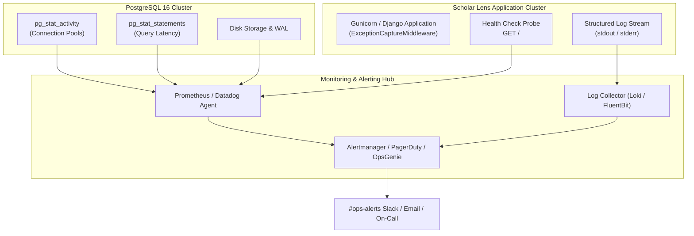

# Scholar Lens — Operations, Monitoring & Incident Response Runbook

**Stage 6: Institutional Deployment Preparation & Production Infrastructure Readiness**  
**Document ID:** `docs/stage6/OPERATIONS_AND_MONITORING.md`  
**Version:** 1.0.0  
**Target Availability SLO:** 99.9% Uptime  
**Confidentiality Standard:** Zero Logging of Credentials, Tokens, Passwords, or Sensitive Academic Records  

---

## 1. Operational Telemetry & Monitoring Architecture

Scholar Lens observability combines application metrics, infrastructure telemetry, structured application logging, and automated health probing.



---

## 2. Service Level Objectives (SLOs) & Key Performance Indicators (KPIs)

| Service Metric | SLI (Indicator) | Target SLO | Warning Threshold | Critical Incident Threshold |
| :--- | :--- | :---: | :---: | :---: |
| **Availability** | Successful HTTP 2xx/3xx requests | $\ge 99.9\%$ | $< 99.5\%$ | $< 99.0\%$ for 5 min |
| **Error Rate** | 5xx Server Errors / Total Requests | $< 0.1\%$ | $> 0.5\%$ | $> 1.0\%$ for 3 min |
| **Response Latency** | HTTP View Duration (p95) | $< 250\text{ ms}$ | $> 500\text{ ms}$ | $> 1500\text{ ms}$ for 5 min |
| **Database Latency** | PostgreSQL Query Duration (p95) | $< 25\text{ ms}$ | $> 50\text{ ms}$ | $> 200\text{ ms}$ for 5 min |
| **Connection Saturation**| Active DB Connections / Max Limit | $< 60\%$ | $> 75\%$ | $> 85\%$ |
| **Disk Storage** | Free space on DB & Media volumes | $> 25\%$ | $< 20\%$ | $< 10\%$ |

---

## 3. The 12 Monitored Operational Vectors

1. **Application Availability:** Monitored via synthetic uptime ping every 30 seconds to the root URL `/`.
2. **HTTP 5xx Server Errors:** Aggregated in real time from Gunicorn access logs; alerts trigger on $>5$ errors in a 1-minute window.
3. **Response Latency:** Tracked across p50, p95, and p99 percentiles to detect performance degradation or thread pool exhaustion.
4. **Database Availability:** Continuous health checks via `SELECT 1;` every 15 seconds.
5. **Database Connections:** Monitored via `pg_stat_activity`; alert if active connections exceed 80% of `max_connections`.
6. **Disk Volume Utilization:** Tracks PostgreSQL data volume and media storage (`/app/media`); alerts trigger at 80% and 90% capacity.
7. **Host CPU & Memory:** System resource consumption monitored; alert on CPU $> 85\%$ or Memory $> 85\%$ sustained for 5 minutes.
8. **Background Task Execution:** Tracks exit codes of cron management commands (`send_funding_alerts`, `refresh_search_index`).
9. **External API Failures:** Tracks error responses and timeouts for OpenAI, Scopus, and Crossref queries.
10. **Authentication Anomalies:** Monitored via Django audit logs for brute-force login attempts or high rates of CSRF token failures.
11. **Automated Backup Vitality:** Verifies successful completion and SHA-256 generation of daily binary `pg_dump` snapshots.
12. **TLS/SSL Certificate Expiration:** Automated alerts at 30 days, 14 days, and 7 days prior to HTTPS certificate expiry.

---

## 4. Structured Logging & Sanitization Standard

### 4.1. Privacy & Security Rules (Zero-Credential Logging)
To comply with institutional privacy rules (FERPA, GDPR, institutional data governance):
- **NEVER LOG:** Passwords, password reset tokens, OAuth client secrets, user session keys, API keys, or full researcher identification numbers.
- **NEVER LOG:** Unredacted student proposal drafts or proprietary patent submissions.

### 4.2. Logging Configuration Architecture
Configured in `scholar_lens/settings.py` with structured formatters:

```python
LOGGING = {
    'version': 1,
    'disable_existing_loggers': False,
    'formatters': {
        'verbose': {
            'format': '{levelname} {asctime} {module} {process:d} {thread:d} {message}',
            'style': '{',
        },
    },
    'handlers': {
        'console': {
            'class': 'logging.StreamHandler',
            'formatter': 'verbose',
        },
    },
    'loggers': {
        'django': {
            'handlers': ['console'],
            'level': 'WARNING',
        },
        'scholar_lens': {
            'handlers': ['console'],
            'level': 'INFO',
        },
    },
}
```

### 4.3. Log Rotation & Retention Policy
For deployments writing to disk:
- **Active Log Location:** `/var/log/scholar_lens/`
- **Rotation Frequency:** Daily rotation using `logrotate` with gzip compression.
- **Local Retention:** 14 days retained locally.
- **Cold Storage Retention:** Aggregated into secure institutional object storage with 90-day retention for audit compliance.

```ini
# /etc/logrotate.d/scholar-lens
/var/log/scholar_lens/*.log {
    daily
    missingok
    rotate 14
    compress
    delaycompress
    notifempty
    create 0640 scholar_lens scholar_lens
    sharedscripts
    postrotate
        systemctl reload scholar-lens.service > /dev/null 2>&1 || true
    endscript
}
```

---

## 5. Health-Check Endpoint Specifications

Scholar Lens provides operational probe endpoints:

1. **Liveness Probe (`GET /`):**
   - Returns: `HTTP 200 OK`
   - Role: Confirms the WSGI server is accepting and dispatching HTTP connections.
2. **Deep System Health Check (CLI / Internal Probe):**
   ```bash
   python -c "
   import django; django.setup()
   from django.db import connection
   with connection.cursor() as cursor:
       cursor.execute('SELECT 1;')
       assert cursor.fetchone()[0] == 1
   print('Database Connection Vitality: HEALTHY')
   "
   ```

---

## 6. Incident Response Runbook

### 6.1. Severity Levels

| Severity | Definition | Target Response | Target Resolution | Escalation Path |
| :---: | :--- | :---: | :---: | :--- |
| **P1 — Critical** | Platform complete outage; database unreachable; critical security compromise. | $< 15\text{ min}$ | $< 2\text{ hours}$ | Lead Architect, SysAdmin, Dean of Research |
| **P2 — Major** | Core module degraded (e.g. Search failing, Facility booking down, Auth degraded). | $< 30\text{ min}$ | $< 6\text{ hours}$ | Senior Backend Engineer, Database Engineer |
| **P3 — Minor** | External enrichment API intermittent (e.g. Scopus timeout, slow export). | $< 2\text{ hours}$ | $< 24\text{ hours}$ | DevOps Engineer |

### 6.2. On-Call Triage Flowchart & Commands

```bash
# 1. Inspect Service Status
sudo systemctl status scholar-lens.service

# 2. Check Recent Application Error Logs
sudo journalctl -u scholar-lens.service -n 100 --no-pager

# 3. Check Database Engine & Active Connections
sudo -u postgres psql -c "SELECT count(*), state FROM pg_stat_activity GROUP BY state;"

# 4. Check Disk & Memory Consumption
df -h /var/lib/postgresql /var/www/scholar_lens
free -m

# 5. Restart Application Workers if Blocked
sudo systemctl restart scholar-lens.service
```

### 6.3. Post-Incident Review (PIR) Protocol
Every P1 or P2 incident requires a formal Post-Incident Review document within 48 hours containing:
1. Incident timeline (Detection, Triage, Mitigation, Resolution).
2. Root cause analysis (RCA) with the "5 Whys" methodology.
3. Corrective actions with assigned ticket IDs and deadlines.
4. Prevention measures to prevent regression.
