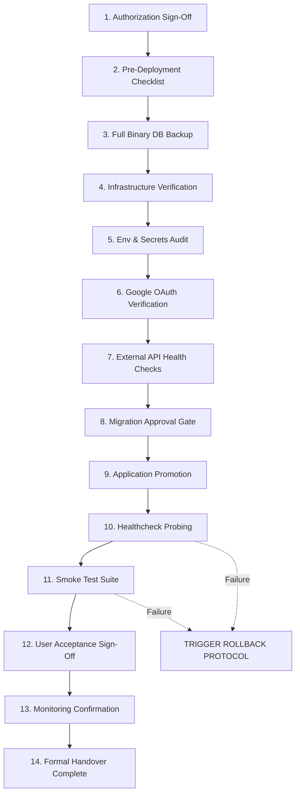

# Scholar Lens — Production Rollout & Rollback Protocol

**Stage 6: Institutional Deployment Preparation & Production Infrastructure Readiness**  
**Document ID:** `docs/stage6/PRODUCTION_ROLLOUT_AND_ROLLBACK.md`  
**Version:** 1.0.0  
**Rollout Strategy:** Zero-Downtime Blue/Green or Controlled Maintenance Window (02:00–04:00 UTC)  
**Safety Protocol:** Strict Pre-Deployment Backup & Explicit Human Gatekeeper Authorization  

---

## 1. Executive Summary & Safety Policy

This document defines the 14-step controlled production deployment protocol for the Scholar Lens platform and establishes strict rollback criteria. In accordance with institutional safety rules:
- **No unapproved deployments:** Production deployment requires explicit two-person authorization.
- **No untested migrations:** Migrations must be dry-run tested in Staging prior to production execution.
- **Zero data loss commitment:** A verified binary snapshot must be taken immediately prior to schema modification.
- **Honest rollback assessment:** Irreversible schema migrations must be acknowledged; snapshot restoration is mandatory if backward-incompatible mutations occur.

---

## 2. The 14-Step Controlled Production Rollout Protocol



### Step 1: Formal Deployment Authorization
- **Requirement:** Written approval from:
  1. Principal Software Architect
  2. Institutional Information Security Officer (ISO)
  3. Dean / Director of Academic Research
- **Record:** Change Request ID, approved deployment window (e.g. Sunday 02:00–04:00 UTC).

### Step 2: Pre-Deployment Go/No-Go Checklist
- Confirm all 10 CI/CD Quality Gates are green on the target release tag.
- Confirm staging acceptance report is signed off.
- Publish institutional maintenance banner if downtime is anticipated.

### Step 3: Full Binary Database Backup
Execute immediate pre-migration snapshot:
```bash
BACKUP_TIMESTAMP=$(date +%Y%m%d_%H%M%S)
pg_dump -h db-prod.internal -U scholar_lens_admin -d scholar_lens \
        -Fc -b -v -f "/var/backups/scholar_lens/pre_prod_${BACKUP_TIMESTAMP}.dump"
sha256sum "/var/backups/scholar_lens/pre_prod_${BACKUP_TIMESTAMP}.dump" > \
          "/var/backups/scholar_lens/pre_prod_${BACKUP_TIMESTAMP}.dump.sha256"
```

### Step 4: Infrastructure & Network Verification
- Verify HTTPS certificate validity: `openssl s_client -connect scholar-lens.university.edu:443 -servername scholar-lens.university.edu < /dev/null | grep -i "Verify return code"`
- Verify PostgreSQL connectivity and extension versions:
  ```sql
  SELECT extname, extversion FROM pg_extension WHERE extname IN ('pg_trgm', 'btree_gist');
  ```

### Step 5: Environment Variable & Secrets Audit
- Confirm `DEBUG=False`.
- Confirm `SECRET_KEY` is high-entropy ($>50$ characters) and unique to production.
- Confirm `ALLOWED_HOSTS` and `CSRF_TRUSTED_ORIGINS` include production FQDN.
- Run `python manage.py check --deploy` (must yield 0 warnings).

### Step 6: Google OAuth Configuration Verification
- Verify Google Cloud Console has registered `https://scholar-lens.university.edu/accounts/google/callback/`.
- Verify JavaScript origins include `https://scholar-lens.university.edu`.

### Step 7: External API Connectivity & Fallback Checks
- Test outbound network reachability to Google OIDC, Crossref, and ORCID endpoints.
- Confirm OpenAI and Scopus fallback handlers operate without unhandled exceptions.

### Step 8: Migration Execution Approval Gate
- Inspect pending migrations: `python manage.py migrate --plan`.
- Apply migrations under transaction:
  ```bash
  python manage.py migrate --noinput
  ```

### Step 9: Application Deployment & Worker Reload
- Deploy container image or update virtualenv code.
- Execute `collectstatic --noinput`.
- Perform zero-downtime worker reload: `sudo systemctl reload scholar-lens.service` or rolling container update.

### Step 10: Healthchecks & Readiness Probing
- Query liveness probe: `curl -I -s https://scholar-lens.university.edu/ | grep "HTTP/1.1 200 OK"`
- Confirm response time is $< 200\text{ ms}$.

### Step 11: Production Smoke Tests
Execute automated smoke test script covering:
1. Public home page rendering.
2. User login endpoint responsiveness.
3. Researcher directory search execution.
4. Facilities booking calendar load.
5. CSRF token generation on forms.

### Step 12: Institutional Stakeholder Sign-Off
- Designate a Faculty member and Research Office representative to perform a 10-minute pilot verification.
- Confirm no visual misalignments, broken links, or permission errors.

### Step 13: Operational Monitoring Confirmation
- Monitor telemetry for 30 minutes:
  - Error rate: must remain $< 0.1\%$.
  - p95 Latency: must remain $< 250\text{ ms}$.
  - Database connection pool: must remain healthy ($< 30$ active connections).

### Step 14: Handover & Deployment Closure
- Remove maintenance advisory banner.
- Archive release manifest with Git commit SHA and backup path.
- Issue formal completion notice to institutional stakeholders.

---

## 3. Comprehensive Rollback Runbook

### 3.1. Rollback Decision Triggers (P1 Criteria)
A rollback **MUST** be initiated immediately if any of the following occur within 60 minutes of deployment:
1. **Critical Outage:** Application returns HTTP 500 errors on $> 1\%$ of requests for 5 consecutive minutes.
2. **Database Failure:** Unrecoverable deadlock, corrupt index, or database connectivity timeout.
3. **Authentication Failure:** Complete failure of user logins (both Google SSO and local credentials).
4. **Data Corruption:** Unauthorized modification or deletion of institutional publication records.

### 3.2. Rollback Execution Procedure

#### Step A: Immediate Traffic Isolation
If severe corruption is occurring, temporarily switch reverse proxy to the maintenance holding page:
```nginx
# /etc/nginx/sites-available/scholar-lens.conf
return 503 "Scholar Lens is currently undergoing scheduled maintenance. Please check back shortly.";
```

#### Step B: Code / Application Reversion
Revert to the previously known stable container image or Git commit:
```bash
# Container rollback
docker pull scholar-lens:previous-stable-tag
docker stop scholar-lens-prod
docker run -d --name scholar-lens-prod ... scholar-lens:previous-stable-tag

# VM / Bare-metal rollback
cd /var/www/scholar_lens
git checkout PREVIOUS_RELEASE_TAG
source venv/bin/activate
pip install -r requirements.txt
python manage.py collectstatic --noinput
```

#### Step C: Database State Evaluation & Recovery
The database recovery procedure depends on the nature of the applied migrations:

> [!WARNING]
> **Irreversible Migration Warning:**  
> If an applied migration performed irreversible schema transformations (e.g. dropping columns, destructive type changes, or data conversions), rolling back Django code alone will leave the database incompatible. In such cases, a complete restoration of the pre-deployment binary snapshot is mandatory.

```bash
# Scenario 1: Reversible Migrations (Additive columns/tables only)
python manage.py migrate <app_name> <previous_migration_number>

# Scenario 2: Irreversible Migrations / Data Mutation -> FULL RESTORE
TARGET_BACKUP="/var/backups/scholar_lens/pre_prod_${BACKUP_TIMESTAMP}.dump"

# 1. Terminate all active database connections
psql -h db-prod.internal -U postgres -c "
SELECT pg_terminate_backend(pid) 
FROM pg_stat_activity 
WHERE datname = 'scholar_lens' AND pid <> pg_backend_pid();"

# 2. Restore database from pre-deployment snapshot
pg_restore -h db-prod.internal \
           -U scholar_lens_admin \
           -d scholar_lens \
           --clean \
           --if-exists \
           -v \
           "$TARGET_BACKUP"

# 3. Re-verify database migrations
python manage.py showmigrations
```

#### Step D: Static and Media Asset Recovery
If static assets were mutated during the failed release:
```bash
python manage.py collectstatic --clear --noinput
```
Media files are stored in persistent, append-only volumes (`/app/media`) and are not modified by standard code deployments.

#### Step E: Service Reactivation & Verification
1. Reload application service: `sudo systemctl restart scholar-lens.service`.
2. Restore Nginx reverse proxy configuration.
3. Verify liveness probe returns HTTP 200.
4. Notify institutional stakeholders that the system has safely restored the previous stable release.
