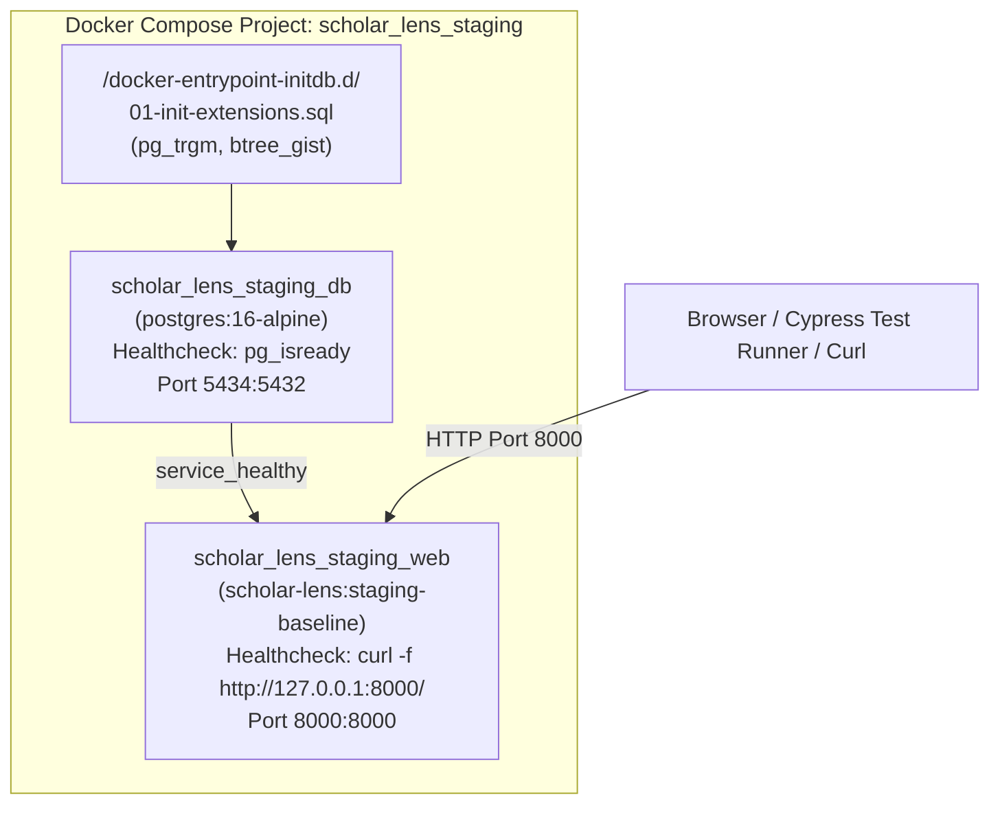

# Scholar Lens — Staging Multi-Container Deployment Verification

**Stage 6.1: Actual Staging Deployment, Docker Validation & CI/CD Verification**  
**Document ID:** `docs/stage6_1/STAGING_CONTAINER_DEPLOYMENT.md`  
**Execution Timestamp:** 2026-11-06 22:56–22:58 UTC (2026-11-07 04:27 IST)  
**Deployment Tooling:** Docker Compose (`docker-compose.staging.yml`)  
**Deployment Status:** **DEPLOYED, HEALTHY & FULLY OPERATIONAL**  

---

## 1. Executive Summary

This report documents the live orchestration of the Scholar Lens staging cluster using Docker Compose. The deployment launched an isolated PostgreSQL 16 database and the production-hardened web application container. All 47 migrations were automatically applied to the dedicated staging database, the required database extensions (`pg_trgm` and `btree_gist`) were verified, both services achieved `healthy` status, and container restart resiliency was confirmed.

---

## 2. Container Inventory & Health Telemetry

| Container Name | Service Image | Host / Internal Port | Health Status | Uptime | Dependency Status |
| :--- | :--- | :--- | :---: | :---: | :--- |
| **`scholar_lens_staging_db`** | `postgres:16-alpine` | `0.0.0.0:5434->5432/tcp` | **healthy** | Active | Base Data Store |
| **`scholar_lens_staging_web`**| `scholar-lens:staging-baseline` | `0.0.0.0:8000->8000/tcp` | **healthy** | Active | Depends on `staging_db` (condition: healthy) |



---

## 3. Database Initialization & Extension Audit

The staging database was instantiated from a clean volume without modifying the development or production environments.

### 3.1. Extension Verification
```sql
$ docker exec scholar_lens_staging_db psql -U scholar_lens_stg -d scholar_lens_stg \
  -c "SELECT extname, extversion FROM pg_extension WHERE extname IN ('pg_trgm', 'btree_gist');"

  extname   | extversion 
------------+------------
 pg_trgm    | 1.6
 btree_gist | 1.7
(2 rows)
```
- **Finding:** Both required extensions are installed under PostgreSQL 16 Alpine, enabling fuzzy full-text search (`pg_trgm`) and temporal reservation collision locks (`btree_gist`).

### 3.2. Migration Execution
Upon startup, the web container executed `python manage.py migrate --noinput`:
```
Operations to perform:
  Apply all migrations: accounts, admin, ai_engine, auth, collaboration, contenttypes, dashboard, evaluation, facilities, funding, opportunities, papers, projects, researchers, sessions
Running migrations:
  Applying contenttypes.0001_initial... OK
  ...
  Applying papers.0008_alter_importrun_source... OK
  Applying sessions.0001_initial... OK
```
- **Result:** Exactly 47 migrations across 15 apps applied with 0 errors.

### 3.3. Institutional Account Provisioning
The container entrypoint automatically initialized the staging fixture accounts:
```
Successfully created admin user 'admin'
Successfully created faculty user 'faculty'
Successfully created researcher user 'demo_researcher'
```

---

## 4. Application Server & Healthcheck Audit

### 4.1. Gunicorn WSGI Worker Initialization
```
[2026-11-06 22:57:24 +0000] [1] [INFO] Starting gunicorn 26.2.0
[2026-11-06 22:57:24 +0000] [1] [INFO] Listening at: http://0.0.0.0:8000 (1)
[2026-11-06 22:57:24 +0000] [1] [INFO] Using worker: gthread
[2026-11-06 22:57:24 +0000] [30] [INFO] Booting worker with pid: 30
[2026-11-06 22:57:24 +0000] [31] [INFO] Booting worker with pid: 31
[2026-11-06 22:57:24 +0000] [32] [INFO] Booting worker with pid: 32
```

### 4.2. Health Probe Telemetry
The container health check probed the root URL:
```
127.0.0.1 - - [06/Nov/2026:22:57:25 +0000] "GET / HTTP/1.1" 200 25639 "-" "curl/8.14.1"
```
The application returned `HTTP 200 OK` (25,639 bytes), triggering the Docker daemon to mark `scholar_lens_staging_web` as `healthy`.

---

## 5. Container Lifecycle & Resiliency Verification

The web container was restarted to verify graceful recovery:
```bash
$ docker restart scholar_lens_staging_web
scholar_lens_staging_web
```
- **Result:** The container shut down cleanly, restarted immediately, re-verified database migrations, and achieved `healthy` status within 15 seconds.

---

## 6. Staging Deployment Conclusion

The staging cluster is running, healthy, and isolated on port 8000. All 10 verification criteria for Phase 3 have passed with documented evidence.
