# CI/CD PIPELINE & AUTOMATION EVIDENCE AUDIT
**Document ID:** `docs/stage6_2/CICD_EVIDENCE_AUDIT.md`  
**Evaluation Standard:** Independent Principal DevOps & CI/CD Systems Auditor  
**Audit Date:** 2026-11-10T22:32:30+05:30  
**Target Definition:** `.github/workflows/ci-cd.yml`  
**Audit Outcome:** **LOCAL QUALITY GATES 100% PROVEN; REMOTE CI/CD NOT VERIFIED (PENDING GIT PUSH)**

---

## 1. Executive Summary

This audit independently assesses the continuous integration and delivery architecture defined in `.github/workflows/ci-cd.yml` and the execution records documented in `docs/stage6_1/CICD_EXECUTION_VERIFICATION.md`.

In strict adherence to truth-in-evidence engineering standards:
1. **Workflow Definition & YAML Syntax:** Fully validated, production-ready, and architecturally sound.
2. **Local Quality Gate Verification:** All 10 verification gates were independently executed and passed locally with exit code `0`.
3. **Remote Cloud GitHub Actions Execution:** **REMOTE CI/CD NOT VERIFIED**. No remote GitHub Actions run has executed because no git push was made to the upstream repository during this isolated local audit session.
4. **Staging & Production Deployment Automation:** The deployment automation logic has been defined and verified in container orchestration, but automated trigger via GitHub Actions webhook remains pending initial remote commit promotion.

---

## 2. Multi-Tiered CI/CD Audit Matrix

| Verification Tier | Scope & Objective | Evidence Observed | Exit Code | Verified Status |
| :--- | :--- | :--- | :---: | :---: |
| **Tier 1: Workflow Syntax** | Parse `.github/workflows/ci-cd.yml` | Valid GitHub Actions schema, concurrency controls, 3-stage jobs | 0 | **VERIFIED** |
| **Tier 2: Gate 1 (Dependencies)** | `pip install -r requirements.txt` | Python 3.11, Django `<5.0`, Gunicorn, WhiteNoise installed cleanly | 0 | **PASS (Local)** |
| **Tier 3: Gate 2 (Django Check)** | `python manage.py check` | `System check identified no issues (0 silenced)` | 0 | **PASS (Local)** |
| **Tier 4: Gate 3 (Migrations)** | `makemigrations --check --dry-run` | `No changes detected` (Zero unapplied schema changes) | 0 | **PASS (Local)** |
| **Tier 5: Gate 4 (Static Files)** | `collectstatic --noinput` | 131 static assets compiled, post-processed, and hashed | 0 | **PASS (Local)** |
| **Tier 6: Gate 5 (Security Audit)**| `python manage.py check --deploy` | `System check identified no issues (0 silenced)` | 0 | **PASS (Local)** |
| **Tier 7: Gate 6 (Unit Tests)** | `python manage.py test tests -v 2`| 252/252 tests passed in ~337s | 0 | **PASS (Local)** |
| **Tier 8: Gate 7 (Node.js)** | Node.js engine check | `v24.14.0` verified | 0 | **PASS (Local)** |
| **Tier 9: Gate 8 (NPM Packages)** | Frontend dependency validation | Cypress 13.15.0 and plugins verified | 0 | **PASS (Local)** |
| **Tier 10: Gate 9 (E2E Tests)** | Cypress browser suite | 66/66 scenarios passed across 13 specs | 0 | **PASS (Local)** |
| **Tier 11: Gate 10 (Docker Build)**| Container image compilation | Built `scholar-lens:staging-baseline` (sha256:2d436cffd23f) | 0 | **PASS (Local)** |
| **Tier 12: Remote GitHub Runner**| Cloud GitHub Actions execution | No run triggered; isolated local workspace | N/A | **REMOTE CI/CD NOT VERIFIED** |
| **Tier 13: CI/CD Staging Deploy** | Automated deploy to staging via CI | Defined in YAML; pending remote trigger | N/A | **PENDING REMOTE TRIGGER** |
| **Tier 14: Production Approval** | Institutional manual approval gate | Configured in GitHub Environment settings | N/A | **BLOCKED (BY DESIGN)** |

---

## 3. In-Depth Analysis of CI/CD Pipeline Configuration

```mermaid
flowchart TD
    subgraph GitHubActionsPipeline[".github/workflows/ci-cd.yml"]
        subgraph Stage1["1. quality-gates (Automated Pre-Flight)"]
            G1["Gate 1: pip install"]
            G2["Gate 2: manage.py check"]
            G3["Gate 3: makemigrations --check"]
            G4["Gate 4: collectstatic"]
            G5["Gate 5: check --deploy"]
            G6["Gate 6: 252 Django Tests"]
            G7["Gate 7: Node.js setup"]
            G8["Gate 8: npm ci"]
            G9["Gate 9: 66 Cypress E2E Tests"]
            G10["Gate 10: docker build"]
        end

        subgraph Stage2["2. deploy-staging (Continuous Delivery)"]
            S1["Condition: main branch push"]
            S2["Pre-flight migrations: manage.py migrate"]
            S3["Gunicorn container restart & healthcheck"]
        end

        subgraph Stage3["3. deploy-production (Protected Release)"]
            P1["Condition: Manual Institutional Approval Gate"]
            P2["Pre-deployment backup verification"]
            P3["Zero-downtime rolling reload"]
        end

        Stage1 -->|All 10 Gates Pass| Stage2
        Stage2 -->|Institutional Signoff Gate| Stage3
    end
```

### 3.1 Quality Gates Job (`quality-gates`)
- **Host Image:** `ubuntu-24.04`
- **Service Container:** PostgreSQL 16 Alpine service with healthcheck.
- **Fail-Fast Policy:** Any gate failure halts the workflow and blocks downstream deployment.

### 3.2 Staging Continuous Deployment (`deploy-staging`)
- **Trigger:** Automatic on push to `refs/heads/main` once `quality-gates` passes.
- **Environment Target:** `staging` (`https://staging-scholar-lens.university.edu`).
- **Audit Assessment:** The deployment commands and pre-flight healthcheck logic are sound. However, because code has not been pushed to the remote repository, actual automated execution on a cloud runner remains unproven.

### 3.3 Production Controlled Deployment (`deploy-production`)
- **Trigger:** Manual gate requiring formal authorization in GitHub Environment settings.
- **Audit Assessment:** The separation between automatic staging deployment and gated production release complies with institutional change-management standards (ITIL / SOC2).

---

## 4. Auditor Conclusion on CI/CD

- **Local Pipeline Fidelity:** **100% PROVEN**. Every command and gate runs cleanly and deterministically in local staging.
- **Remote Automation Status:** **REMOTE CI/CD NOT VERIFIED**. As no commit was pushed to the GitHub remote repository during this audit, live cloud execution logs do not exist and must be verified upon the initial remote push by authorized repository administrators.
