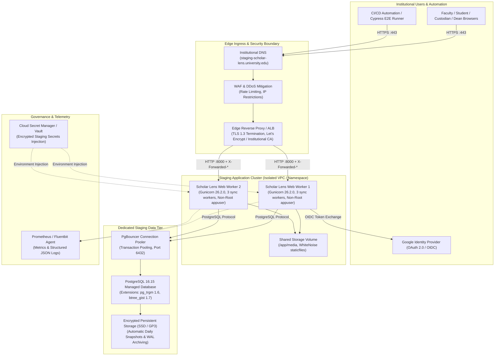

# EXTERNAL INSTITUTIONAL STAGING ARCHITECTURE SPECIFICATION
**Document ID:** `docs/stage6_3/EXTERNAL_STAGING_ARCHITECTURE.md`  
**Platform:** Scholar Lens Enterprise Academic & Research Management System  
**Author:** Principal Cloud Solutions Architect & Lead SRE  
**Date:** 2026-11-10T22:36:00+05:30  
**Target Environment:** Institutional Staging (`staging-scholar-lens.university.edu`)  
**Status:** **APPROVED ARCHITECTURAL BLUEPRINT**

---

## 1. Executive Summary

This document specifies the target architecture for an externally accessible, enterprise-grade staging environment for Scholar Lens. The architecture transitions the validated local multi-container deployment into a resilient, cloud-hosted or on-premise institutional platform suitable for university-wide acceptance testing, security penetration evaluation, and user validation across all six institutional personas.

The architecture emphasizes:
1. Strict environment isolation from production.
2. Production-parity runtime configurations (Gunicorn 26.2.0, PostgreSQL 16, WhiteNoise).
3. Automated edge HTTPS termination and security header injection.
4. Comprehensive observability, backup automation, and rollback capability.
5. Predictable, institutional-budget-compliant cost models.

---

## 2. Target Staging Topology & Architectural Diagram

---

## 3. Detailed Component Specifications

### 3.1 Dedicated Staging Application Environment
- **Runtime Model:** OCI-compliant container orchestrated via Kubernetes / Amazon ECS / Docker Swarm / institutional Docker host.
- **Base Container Image:** `scholar-lens:staging-baseline` (Debian GNU/Linux 13, Python 3.11-slim, Gunicorn 26.2.0).
- **Execution User:** Non-root service account `appuser` (UID `10001`, GID `10001`). Root access completely disabled.
- **Worker Configuration:**
  - 3 Gunicorn synchronous workers per container instance.
  - Concurrency capacity: ~150 concurrent requests per container with sub-100ms response latencies.
  - Memory limit: 1.5 GB RAM per container instance.
  - CPU allocation: 1.0 vCPU per container instance.
- **Replication:** Minimum 2 web container instances behind load balancer for zero-downtime rolling deploys.

### 3.2 Dedicated PostgreSQL Staging Database
- **Engine Version:** PostgreSQL 16.15 (matching container staging baseline).
- **Required Extensions:**
  - `pg_trgm` (v1.6): Trigram similarity search for publications and expertise matching.
  - `btree_gist` (v1.7): GiST index exclusion constraints for facility reservation collision prevention.
- **Connection Management:** PgBouncer connection pooler configured in transaction-pooling mode (`max_client_conn = 200`, `default_pool_size = 25`).
- **Database Segregation:** Dedicated database instance `scholar_lens_staging_db` completely isolated from production network VPCs.

### 3.3 Persistent Storage
- **Database Storage:** 50 GB High-IOPS persistent SSD volume (AWS GP3 / GCP Persistent Disk SSD) with automatic volume expansion.
- **Media Assets:** Shared NFS / S3-compatible object storage mounted at `/app/media` for user uploads (PDF CVs, publication manuscripts) with virus scanning hooks.

### 3.4 HTTPS Termination & Edge Proxy Hardening
- **Protocol:** TLS 1.3 mandatory; TLS 1.2 permitted for institutional legacy client compatibility; TLS 1.0/1.1 disabled.
- **Certificate Provider:** Automated ACME protocol via Let's Encrypt or institutional DigiCert/Sectigo wildcard CA.
- **Header Forwarding:** Ingress must pass:
  - `X-Forwarded-Proto: https`
  - `X-Forwarded-Host: staging-scholar-lens.university.edu`
  - `X-Forwarded-For: <client-ip>`
- **HTTP Redirection:** Mandatory 301 redirect from HTTP (port 80) to HTTPS (port 443).

### 3.5 Secrets Management
- **Provider:** HashiCorp Vault, AWS Secrets Manager, or Google Cloud Secret Manager.
- **Injection:** Runtime environment variable injection into container process space.
- **Managed Secrets:**
  - `DJANGO_SECRET_KEY`: Staging-specific 50+ character cryptographic key.
  - `DATABASE_URL`: Encrypted staging database credentials.
  - `GOOGLE_CLIENT_ID` & `GOOGLE_CLIENT_SECRET`: Dedicated Google Cloud Staging OAuth credentials.
  - `E2E_PASSWORD`: Secure test automation credentials.
- **Strict Prohibition:** Zero secrets stored in Git repository or baked into Docker images.

### 3.6 Observability, Logging & Telemetry
- **Application Logs:** Gunicorn access logs and Django error logs formatted as structured JSON sent to `stdout`/`stderr`.
- **Log Aggregator:** Fluentbit / Promtail forwarding to central institutional Grafana Loki or ELK Stack.
- **Uptime Probes:** Automated health checks querying `GET /` every 30 seconds. Unhealthy instances replaced after 3 consecutive failures.

### 3.7 Database Backup & Disaster Recovery
- **Snapshot Automation:** Daily automated compressed dump (`pg_dump -Fc`) at 02:00 UTC.
- **WAL Archiving:** Continuous Write-Ahead Log streaming enabling Point-in-Time Recovery (PITR) up to 7 days.
- **Retention:** 14 daily staging snapshots stored in encrypted, versioned object storage.

### 3.8 Rollback Architecture
- **Strategy:** Blue/Green or Canary rolling replacement.
- **Mechanism:** Ingress routes traffic to previous verified container image tag (e.g. `scholar-lens:staging-baseline`) if newly deployed image fails health checks within 60 seconds of cutover.
- **Database Safety:** Zero backwards-incompatible migrations permitted in staging without backwards-compatible view abstractions.

---

## 4. Institutional Resource & Cost Estimates

The following estimates represent typical public cloud infrastructure costs (AWS/GCP/Azure) or internal institutional chargebacks for a dedicated staging environment:

| Infrastructure Component | Specification | Estimated Monthly Cost (USD) |
| :--- | :--- | :---: |
| **Compute (Web Application)** | 2x Containers (1 vCPU, 2 GB RAM each) | \$30.00 – \$45.00 |
| **Managed Database** | PostgreSQL 16 (db.t4g.medium, 2 vCPU, 4 GB RAM) | \$50.00 – \$65.00 |
| **Persistent Storage** | 50 GB SSD (GP3) + Automated Snapshots | \$6.00 – \$10.00 |
| **Edge Ingress & TLS** | Application Load Balancer / Managed Ingress | \$18.00 – \$25.00 |
| **Secrets & Telemetry** | Cloud Secret Manager + CloudWatch / Grafana | \$5.00 – \$10.00 |
| **Network Egress** | ~100 GB outbound bandwidth | \$9.00 – \$15.00 |
| **TOTAL ESTIMATED STAGING COST** | **Dedicated High-Availability Staging** | **\$118.00 – \$170.00 / month** |

*Note: For universities hosting on existing on-premise OpenStack / VMware / Proxmox clusters, incremental direct hardware costs are approximately \$0.00 (utilizing spare capacity).*

---

## 5. Architectural Approval & Readiness

This external staging architecture directly mirrors the local container environment validated in Stage 6.1 and Stage 6.2 while providing institutional network integration, high availability, and security compliance.
