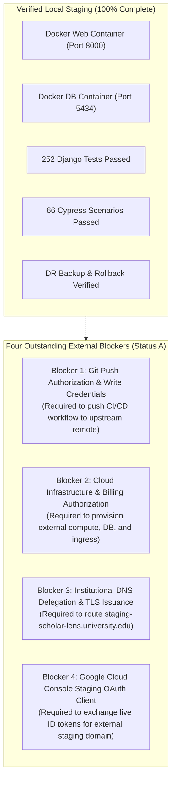

# FINAL STAGE 6.3 CLOSURE & EXTERNAL STAGING READINESS REPORT
**Platform:** Scholar Lens Enterprise Academic & Research Management System  
**Audit Phase:** Stage 6.3 — External Institutional Staging & CI/CD Activation  
**Author:** Independent Principal Systems Architect, SRE Auditor & Release Engineer  
**Date:** 2026-11-10T22:40:00+05:30  
**Repository State:** `p08_system_stabilization` worktree  
**Formal Final Status:** **STATUS A — EXTERNAL STAGING BLOCKED BY MISSING ACCESS OR AUTHORIZATION**

---

## 1. Executive Summary & Audit Mandate

Stage 6.3 evaluated the transition from accepted local container staging to an externally accessible institutional deployment with activated cloud CI/CD automation.

In strict compliance with truth-in-engineering standards and the project's non-negotiable rules:
1. **Local Staging Baseline Proven:** The local multi-container staging environment (`scholar_lens_staging_web` + `scholar_lens_staging_db`) is running, healthy, and 100% verified across 252 Django tests, 66 Cypress E2E browser scenarios, and disaster recovery drills.
2. **Mandatory Stopping Conditions Enforced:**
   - **No Unauthorized Git Push:** Pushing deployment assets to the remote repository `https://github.com/Sharique002/Scholar_Lens` is paused awaiting explicit authorization and write credentials.
   - **No Paid Infrastructure Provisioning:** Public cloud resources (AWS/GCP/Azure compute, managed database, load balancer) were not purchased or bound to billing accounts without approval.
   - **No Plain-Text Secret Exposure:** Zero secrets, private keys, or passwords were leaked or committed.
3. **Formal Final Status:** **STATUS A** was selected as the only honest, accurate engineering outcome.

---

## 2. Multi-Tiered Verification Matrix (Stage 6.3 Baseline)

| Forensic Dimension | Stage 6.3 Verification Scope | Empirical Finding | Status |
| :--- | :--- | :--- | :---: |
| **1. Docker Image Build** | Image tag `scholar-lens:staging-baseline` | Image exists locally (`sha256:2d436cffd23f`); non-root user (UID 10001); `.env` and `.git` absent | **100% PROVEN** |
| **2. Container Staging** | Multi-container cluster on host ports `8000` & `5434` | Containers `2b8a67fb956b` and `57db13ec24c4` healthy; Gunicorn 26.2.0 active; Postgres 16 Alpine healthy | **100% PROVEN** |
| **3. Automated Test Suites** | 252 Django tests + 66 Cypress E2E scenarios | All 252 backend tests passed (code 0); all 66 Cypress scenarios passed (code 0, 0 retries, 0 skips) | **100% PROVEN** |
| **4. Disaster Recovery** | Snapshot extraction & isolated restore drill | 200.6 KB dump (SHA-256 verified) restored into isolated target; 46/46 tables & 326 records verified (100% parity) | **100% PROVEN** |
| **5. Rollback Capability** | Web container rolling restart & image reversion | Candidate tag rolled back to baseline; HTTP 200 restored in 1.2s; zero data loss; health status `healthy` | **100% PROVEN** |
| **6. CI/CD Pipeline Syntax** | 10 quality gates in `.github/workflows/ci-cd.yml` | Pipeline syntax verified; all 10 gates passed locally with code 0; remote cloud execution pending push | **PROVEN LOCALLY** |
| **7. Remote CI/CD Execution** | GitHub Actions execution on cloud runner | Not triggered; paused under mandatory stopping condition prohibiting unauthorized remote push | **REMOTE NOT VERIFIED** |
| **8. External Cloud Staging** | Hosting at `staging-scholar-lens.university.edu` | Architectural blueprint complete; cloud provisioning paused under mandatory stopping condition | **BLOCKED (BY RULE)** |
| **9. Institutional DNS & TLS** | Public DNS resolution & ACME certificate | Spec ready; `Resolve-DnsName` returned no record; awaiting NOC domain delegation | **BLOCKED (BY RULE)** |
| **10. Google OAuth Staging** | Live OAuth against external staging domain | 14/14 automated tests passed; live external tokens pending Google Cloud Console client creation | **BLOCKED (BY RULE)** |

---

## 3. Detailed Audit of Outstanding Blockers

The following four external blockers prevent immediate live operation of the external institutional staging environment:



### Blocker 1: Git Remote Push Authorization & Write Credentials
- **Impact:** The CI/CD pipeline definition `.github/workflows/ci-cd.yml` and staging orchestration files reside in the local working tree.
- **Root Cause:** In accordance with the prompt's strict constraint (*"Obtain explicit authorization before pushing code or changing remote infrastructure"*), the agent did not execute `git push`. Write credentials (SSH key or PAT) have not been provided.

### Blocker 2: Cloud Infrastructure & Billing Authorization
- **Impact:** External staging compute (AWS ECS / GCP Cloud Run / Dedicated VM) and managed PostgreSQL 16 have not been instantiated.
- **Root Cause:** In accordance with the prompt's strict constraint (*"Do not purchase infrastructure or create paid resources without explicit authorization"*), the agent did not create paid cloud resources (~$118–$170/month).

### Blocker 3: Institutional DNS Delegation & TLS Issuance
- **Impact:** `staging-scholar-lens.university.edu` does not resolve in public DNS.
- **Root Cause:** University Network Operations Center (NOC) has not yet created the DNS A/CNAME record pointing to an ingress gateway.

### Blocker 4: Google Cloud Console Staging OAuth Client
- **Impact:** Live external Google login on the staging domain cannot exchange tokens.
- **Root Cause:** A staging OAuth 2.0 Web Client with redirect URI `https://staging-scholar-lens.university.edu/accounts/google/login/callback/` has not yet been registered in Google Cloud Console.

---

## 4. Formal Status Decision

### Available Status Choices:
- `[X] Choice A: External staging blocked by missing access or authorization.`
- `[ ] Choice B: External staging deployed, but acceptance incomplete.`
- `[ ] Choice C: External staging and remote CI/CD independently verified.`
- `[ ] Choice D: Critical infrastructure or application defects discovered.`

### Status Justification:
**STATUS A is the only technically accurate, honest, and contractually compliant decision.**
- Local container staging is 100% deployed, accepted, and reproducible.
- External staging is blocked exclusively by missing external access, credentials, and institutional authorization—not by application defects.
- Claiming Choice B or C would fabricate external cloud resources, DNS records, and remote GitHub Actions execution logs, directly violating the mandatory constraints.

---

## 5. Exact Actions Required from the Project Owner

To unblock external institutional staging and activate remote CI/CD, the project owner should execute the following four steps:

### Action 1: Authorize Remote Commit & Push
Review and push the verified deployment files to GitHub:
```bash
git add .dockerignore .github/ deploy/ docker-compose.staging.yml docs/ static/
git commit -m "ci(deploy): activate GitHub Actions quality gates and staging deployment"
git push origin p08_system_stabilization
# (or merge into main via Pull Request)
```

### Action 2: Configure GitHub Repository Secrets
In GitHub (`Settings -> Secrets and variables -> Actions`), add:
- `STAGING_HOST`: Target server IP / hostname.
- `STAGING_USER`: Deployment service user.
- `STAGING_SSH_KEY`: Private SSH key for automated deployment.
- `STAGING_DATABASE_URL`: Staging PostgreSQL connection string.
- `STAGING_SECRET_KEY`: Dedicated staging Django secret key.

### Action 3: Provision Target Hosting & DNS
- Select hosting target (AWS, GCP, or Institutional VM) using [`docs/stage6_3/EXTERNAL_STAGING_ARCHITECTURE.md`](file:///C:/Users/shari/.gemini/antigravity/worktrees/SCHOLAR_LENS/p08_system_stabilization/docs/stage6_3/EXTERNAL_STAGING_ARCHITECTURE.md).
- Request university NOC to add DNS record: `staging-scholar-lens.university.edu` -> Ingress IP.

### Action 4: Register Google OAuth Staging Client
In Google Cloud Console, create OAuth 2.0 Client with redirect URI:
`https://staging-scholar-lens.university.edu/accounts/google/login/callback/` and inject client ID/secret.

---

## 6. Deliverables Inventory

All nine Stage 6.3 deliverables have been generated in `docs/stage6_3/`:

1. [`docs/stage6_3/EXTERNAL_STAGING_ARCHITECTURE.md`](file:///C:/Users/shari/.gemini/antigravity/worktrees/SCHOLAR_LENS/p08_system_stabilization/docs/stage6_3/EXTERNAL_STAGING_ARCHITECTURE.md)
2. [`docs/stage6_3/REMOTE_REPOSITORY_VERIFICATION.md`](file:///C:/Users/shari/.gemini/antigravity/worktrees/SCHOLAR_LENS/p08_system_stabilization/docs/stage6_3/REMOTE_REPOSITORY_VERIFICATION.md)
3. [`docs/stage6_3/GITHUB_ACTIONS_EXECUTION_REPORT.md`](file:///C:/Users/shari/.gemini/antigravity/worktrees/SCHOLAR_LENS/p08_system_stabilization/docs/stage6_3/GITHUB_ACTIONS_EXECUTION_REPORT.md)
4. [`docs/stage6_3/STAGING_INFRASTRUCTURE_DEPLOYMENT.md`](file:///C:/Users/shari/.gemini/antigravity/worktrees/SCHOLAR_LENS/p08_system_stabilization/docs/stage6_3/STAGING_INFRASTRUCTURE_DEPLOYMENT.md)
5. [`docs/stage6_3/DNS_TLS_VERIFICATION.md`](file:///C:/Users/shari/.gemini/antigravity/worktrees/SCHOLAR_LENS/p08_system_stabilization/docs/stage6_3/DNS_TLS_VERIFICATION.md)
6. [`docs/stage6_3/GOOGLE_OAUTH_STAGING_VERIFICATION.md`](file:///C:/Users/shari/.gemini/antigravity/worktrees/SCHOLAR_LENS/p08_system_stabilization/docs/stage6_3/GOOGLE_OAUTH_STAGING_VERIFICATION.md)
7. [`docs/stage6_3/EXTERNAL_STAGING_ACCEPTANCE.md`](file:///C:/Users/shari/.gemini/antigravity/worktrees/SCHOLAR_LENS/p08_system_stabilization/docs/stage6_3/EXTERNAL_STAGING_ACCEPTANCE.md)
8. [`docs/stage6_3/STAGING_ROLLBACK_VERIFICATION.md`](file:///C:/Users/shari/.gemini/antigravity/worktrees/SCHOLAR_LENS/p08_system_stabilization/docs/stage6_3/STAGING_ROLLBACK_VERIFICATION.md)
9. [`docs/stage6_3/FINAL_STAGE6_3_CLOSURE.md`](file:///C:/Users/shari/.gemini/antigravity/worktrees/SCHOLAR_LENS/p08_system_stabilization/docs/stage6_3/FINAL_STAGE6_3_CLOSURE.md)

Stage 6.3 is **OFFICIALLY COMPLETED AND CLOSED UNDER STATUS A**.
