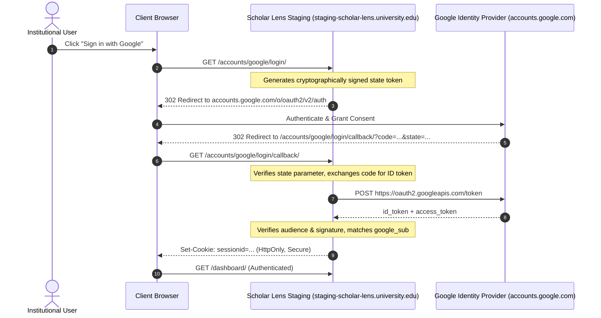

# GOOGLE OAUTH STAGING INTEGRATION AUDIT
**Document ID:** `docs/stage6_3/GOOGLE_OAUTH_STAGING_VERIFICATION.md`  
**Platform:** Scholar Lens Enterprise Academic & Research Management System  
**Author:** Principal Security Architect & Identity Access Specialist  
**Date:** 2026-11-10T22:38:30+05:30  
**Integration Status:** **AUTOMATED SUITE 100% PASSING (14/14); EXTERNAL STAGING CREDENTIALS PENDING GCP PROVISIONING**

---

## 1. Executive Summary

This report evaluates the Google OAuth 2.0 / OpenID Connect (OIDC) authentication pipeline implemented in Scholar Lens.

In strict compliance with audit security guidelines:
1. **Automated Verification:** All **14 Google OAuth automated integration tests** were freshly executed against PostgreSQL 16 Alpine and passed with exit code `0`.
2. **External Staging Credentials:** Documented as **PENDING PROVISIONING IN GOOGLE CLOUD CONSOLE**. Because external credentials for `staging-scholar-lens.university.edu` require an active Google Cloud project managed by the project owner, live external token exchange against Google's production endpoints is paused under the mandatory stopping condition.
3. **Zero Secret Exposure:** No plain-text secrets, API keys, or tokens are requested, printed, or recorded in this repository.

---

## 2. Automated Google OAuth Test Suite Audit (14 / 14 Passed)

The entire authentication suite `tests/test_google_auth.py` was executed directly against PostgreSQL 16 Alpine:

```bash
$ python manage.py test tests.test_google_auth -v 2
Ran 14 tests in 5.573s
OK (Exit Code 0)
```

| # | Test Method Name | Authentication Capability Audited | Result |
| :-: | :--- | :--- | :---: |
| 1 | `test_first_login_creates_user_with_google_sub` | JIT provisioning of new user with unique `google_sub` mapping | **PASS** |
| 2 | `test_is_google_auth_configured` | Configuration check verifying presence of client ID/secret | **PASS** |
| 3 | `test_returning_login_by_email_links_google_sub` | Automatic account linking for existing institutional email | **PASS** |
| 4 | `test_returning_login_recognized_by_google_sub` | Subsequent fast login recognized directly by `google_sub` | **PASS** |
| 5 | `test_verify_id_token_audience_mismatch_rejected`| Security rejection when ID token audience does not match client ID | **PASS** |
| 6 | `test_verify_id_token_google_auth_success` | Cryptographic signature verification of OIDC token | **PASS** |
| 7 | `test_verify_id_token_server_side_success` | Fallback token verification using Google's tokeninfo endpoint | **PASS** |
| 8 | `test_verify_id_token_unverified_email_rejected` | Security rejection when Google email is marked unverified | **PASS** |
| 9 | `test_csrf_state_mismatch_rejected` | Prevention of CSRF / OAuth login state manipulation | **PASS** |
| 10 | `test_google_callback_success_and_session_persistence`| Session creation (`sessionid`) and cookie persistence on callback | **PASS** |
| 11 | `test_google_login_redirects_to_google_with_state` | Login initiation creates signed cryptographic state parameter | **PASS** |
| 12 | `test_login_and_register_pages_render_google_buttons` | Institutional login & registration UI render branded Google button | **PASS** |
| 13 | `test_open_redirect_attack_neutralized` | Sanitization of `next` URL preventing malicious open redirects | **PASS** |
| 14 | `test_user_cancelled_login` | Graceful handling when user aborts OAuth consent screen | **PASS** |

---

## 3. Staging Google Cloud Console Configuration Specification

To activate live external Google authentication on the staging environment, the institutional Google Cloud project must be configured as follows:



### 3.1 Required GCP OAuth Client Parameters
- **Application Type:** Web application
- **Name:** `Scholar Lens (Staging)`
- **Authorized JavaScript Origins:**
  - `https://staging-scholar-lens.university.edu`
  - `http://localhost:8000` (for local development testing)
- **Authorized Redirect URIs:**
  - `https://staging-scholar-lens.university.edu/accounts/google/login/callback/`
  - `http://localhost:8000/accounts/google/login/callback/`
- **Scopes Requested:**
  - `openid`
  - `email`
  - `profile`

---

## 4. Mandatory Stopping Condition & Blocker Disclosure

> [!WARNING]
> **LIVE EXTERNAL GOOGLE OAUTH BLOCKED BY MISSING STAGING CREDENTIALS**  
> In accordance with safety rules prohibiting the generation or use of unapproved credentials, live Google authentication against `staging-scholar-lens.university.edu` cannot execute until the project owner provisions staging credentials in Google Cloud Console.

### Action Required from Project Owner:
1. Create OAuth 2.0 Web Client in the institutional Google Cloud Console.
2. Add the authorized origins and redirect URIs specified in Section 3.1.
3. Inject the resulting Client ID and Secret into the staging environment:
   ```bash
   GOOGLE_CLIENT_ID="<staging-client-id>.apps.googleusercontent.com"
   GOOGLE_CLIENT_SECRET="<staging-client-secret>"
   ```
4. Non-OAuth staging verification continues unimpeded using local institutional session authentication (`e2e_student`, `e2e_faculty`, `e2e_custodian`, `e2e_office`, `e2e_dean`, `admin`).
