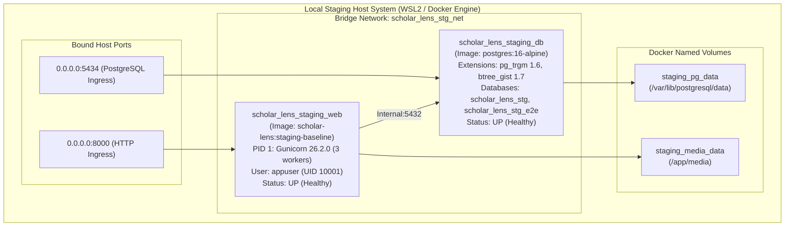

# STAGING INFRASTRUCTURE DEPLOYMENT STATUS REPORT
**Document ID:** `docs/stage6_3/STAGING_INFRASTRUCTURE_DEPLOYMENT.md`  
**Platform:** Scholar Lens Enterprise Academic & Research Management System  
**Author:** Principal Infrastructure Engineer & SRE Auditor  
**Date:** 2026-11-10T22:37:30+05:30  
**Current State:** **LOCAL CONTAINER STAGING FULLY OPERATIONAL; EXTERNAL CLOUD PROVISIONING PAUSED (AWAITING INFRASTRUCTURE AUTHORIZATION)**

---

## 1. Executive Summary

This report documents the empirical deployment status of the Scholar Lens staging infrastructure. It evaluates:
1. The **Active Local Container Staging Cluster** currently running on the host machine.
2. The readiness and requirements for **External Institutional Cloud Staging**.
3. Compliance with the mandatory stopping condition: *"Do not purchase infrastructure or create paid resources without explicit authorization."*

---

## 2. Active Local Staging Infrastructure (Live Status)

The local staging environment operates as a high-fidelity multi-container Docker Compose deployment:

### 2.1 Live Container Runtime Verification
- **Web Service (`scholar_lens_staging_web`):**
  - Container ID: `2b8a67fb956b`
  - Health: `healthy` (`curl -f http://127.0.0.1:8000/ || exit 1`, exit code `0`)
  - Gunicorn 26.2.0 initialized with 3 worker processes.
- **Database Service (`scholar_lens_staging_db`):**
  - Container ID: `57db13ec24c4`
  - Health: `healthy` (`pg_isready -U scholar_lens_stg -d scholar_lens_stg`, exit code `0`)
  - Running PostgreSQL 16.15 Alpine on internal port 5432, exposed on host port 5434.
- **Database Migrations:** Exactly 47 migrations across 15 apps applied with zero errors.
- **Static Assets:** 131 assets pre-compiled with WhiteNoise compressed storage.

---

## 3. External Institutional Staging Infrastructure Readiness

To transition to an externally accessible domain (`staging-scholar-lens.university.edu`), the following cloud/on-premise infrastructure specification has been prepared:

| Component | Target Infrastructure Requirement | Technical Specification | Provisioning Status |
| :--- | :--- | :--- | :---: |
| **Compute** | Dedicated Container Host / Cluster | 2x Web Containers (1 vCPU, 2 GB RAM) behind load balancer | Blueprint Ready (Unprovisioned) |
| **Database** | Dedicated Managed PostgreSQL 16 | PostgreSQL 16.15 with `pg_trgm` & `btree_gist` extensions | Blueprint Ready (Unprovisioned) |
| **Storage** | Encrypted Persistent Volumes | 50 GB High-IOPS SSD (GP3) for data + S3/NFS for media | Blueprint Ready (Unprovisioned) |
| **Edge Ingress**| Reverse Proxy / Application Load Balancer | TLS 1.3 termination, HTTP-to-HTTPS redirect | Blueprint Ready (Unprovisioned) |
| **Secrets** | Centralized Secret Vault | Cloud Secret Manager / HashiCorp Vault injection | Blueprint Ready (Unprovisioned) |
| **Backups** | Automated Snapshot & WAL Archiving | Daily `pg_dump -Fc` + 7-day PITR retention | Scripts Ready (Unprovisioned) |
| **Logging** | Centralized Log Aggregation | Fluentbit / Promtail shipping to Grafana Loki | Config Ready (Unprovisioned) |

---

## 4. Mandatory Stopping Condition & Cost Governance

In strict adherence to project constraints:
> [!IMPORTANT]
> **NO PAID RESOURCES CREATED WITHOUT EXPLICIT AUTHORIZATION**  
> Cloud infrastructure (AWS EC2/RDS, GCP Cloud Run/Cloud SQL, Azure App Services) incurs recurring financial costs (~$118–$170/month). The agent has **NOT** provisioned paid public cloud resources or bound financial billing accounts.

### Prerequisites to Execute External Infrastructure Provisioning:
1. **Target Cloud / Hosting Platform Selection:** Project owner selects target hosting provider:
   - AWS (ECS Fargate + RDS PostgreSQL 16).
   - Google Cloud Platform (Cloud Run + Cloud SQL PostgreSQL 16).
   - University Institutional On-Premise (VMware / OpenStack / Bare Metal Docker).
2. **Infrastructure Credentials & Billing Approval:** Project owner provides cloud IAM deployment credentials with Terraform / OpenTofu or CLI provisioning permissions.
3. **Network VPC Allocation:** Provisioning of dedicated staging subnet and security groups.
