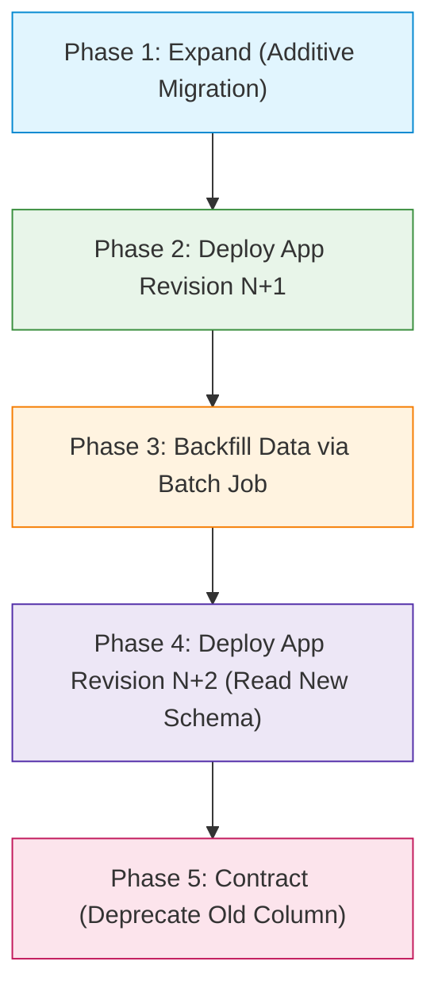

# Scholar Lens — Backup, Rollback & Disaster Recovery Plan

**Document ID:** `SL-STAGE7-DR-PLAN-001`  
**Date:** 2026-11-10  
**Phase:** Stage 7 — GCP Free-Tier Deployment Preparation & Production Readiness  
**Target Environment:** GCP Cloud Run (Compute) + Neon Serverless PostgreSQL / Cloudflare R2 / GCS  
**Author:** AI Systems Engineer & Infrastructure Specialist  

---

## 1. Executive Summary

This document establishes the institutional operational protocols for zero-downtime deployment, sub-minute application rollback, automated database backup, point-in-time recovery, and emergency disaster response for Scholar Lens. 

Because Scholar Lens is hosted on Google Cloud Run with an external PostgreSQL database (Neon Serverless for pilot staging, dedicated managed PostgreSQL for institutional production), compute and data tiers are cleanly decoupled. This enables independent rollback and disaster recovery strategies.

---

## 2. Cloud Run Application Rollback Protocol

Google Cloud Run is immutable and revision-based. Every deployment creates a uniquely numbered, immutable container revision (e.g., `scholar-lens-staging-00042`).

### 2.1 Instantaneous Traffic Shifting (Sub-5-Second Rollback)
If a newly deployed revision encounters an uncaught exception, memory regression, or health check failure, traffic can be redirected to the previous known-healthy revision with zero container rebuild delay:

```bash
# Shift 100% of incoming staging traffic immediately to the previous revision
gcloud run services update-traffic scholar-lens-staging \
  --project=scholar-lens-staging \
  --region=asia-south1 \
  --to-revisions=scholar-lens-staging-00041=100
```

#### Via GCP Console:
1. Navigate to **Cloud Run** > Services > `scholar-lens-staging`.
2. Click the **Revisions** tab.
3. Click **Manage Traffic**.
4. Set the allocation for the healthy revision to `100%` and the regressed revision to `0%`.
5. Click **Save**. Traffic shifts within 1 to 3 seconds globally.

### 2.2 Blue/Green & Canary Traffic Allocation
Before directing 100% of user traffic to a new deployment, traffic can be safely split:
```bash
# Canary test: send 10% of traffic to new revision, keep 90% on stable revision
gcloud run services update-traffic scholar-lens-staging \
  --to-revisions=scholar-lens-staging-00042=10,scholar-lens-staging-00041=90
```

---

## 3. Database Backup & Disaster Recovery Architecture

### 3.1 Neon Serverless PostgreSQL (Pilot Staging)
Neon provides copy-on-write storage architecture with built-in branching and point-in-time recovery.

1. **Continuous WAL Archiving:** Write-Ahead Logs (WAL) are streamed continuously to fault-tolerant object storage.
2. **Point-In-Time Recovery (PITR):** Neon Free supports instant point-in-time restore up to 24 hours. The database can be rewound to any specific second prior to an erroneous migration or accidental deletion.
3. **Instant Branching:** Before applying risky migrations, a branch (e.g., `staging-pre-migration-snap`) can be created instantly (in < 1 second) without copying data.

### 3.2 Automated Daily Logical Dump (`pg_dump`)
To ensure vendor-neutral disaster recovery independent of any specific database provider, an automated logical backup routine is scheduled:

```bash
#!/usr/bin/env bash
# backup_staging_db.sh
set -euo pipefail

BACKUP_DATE=$(date -u +%Y%m%d_%H%M%SZ)
BACKUP_FILE="/tmp/scholar_lens_backup_${BACKUP_DATE}.dump"
GCS_DESTINATION="gs://scholar-lens-staging-backups/database/"

echo "[+] Initiating logical backup for Scholar Lens Staging..."
pg_dump --format=custom \
        --no-owner \
        --no-privileges \
        --file="${BACKUP_FILE}" \
        "${DATABASE_URL}"

echo "[+] Backup created: ${BACKUP_FILE} ($(du -h ${BACKUP_FILE} | cut -f1))"

# Encrypt and upload to cold storage
echo "[+] Uploading backup to secure storage..."
gsutil cp "${BACKUP_FILE}" "${GCS_DESTINATION}"

# Purge local temp
rm -f "${BACKUP_FILE}"
echo "[+] Backup successfully archived."
```

### 3.3 Recovery Metrics & Targets
- **Recovery Point Objective (RPO):**
  - Staging / Pilot: RPO ≤ 1 hour (via continuous WAL archiving in Neon) or 24 hours (daily logical dump).
  - Institutional Production: RPO ≤ 5 minutes (continuous WAL archiving with multi-region replication).
- **Recovery Time Objective (RTO):**
  - Application Rollback: RTO ≤ 10 seconds (Cloud Run traffic switch).
  - Database PITR Restore: RTO ≤ 5 minutes (instant branch / point-in-time pointer shift).
  - Full Cold Database Re-import: RTO ≤ 15 minutes (restore from logical dump).

---

## 4. Zero-Downtime Database Migration Protocol

When application code changes depend on database schema updates, rolling back code alone can cause errors if the database schema was modified destructively. Scholar Lens enforces **Expand-and-Contract** (additive-only) migrations:



### 4.1 Strict Migration Safety Rules
1. **Never Drop or Rename Columns in a Single Release:**
   - *Forbidden:* Renaming `opportunity_title` to `title` directly.
   - *Allowed:* Add `title` as a nullable column; duplicate writes to both; backfill; switch reads; drop `opportunity_title` in a subsequent release.
2. **Never Add Non-Nullable Columns Without Default Values:**
   - Adding a non-nullable column without a default locks the table and causes immediate `IntegrityError` exceptions on older application revisions.
3. **Use Concurrent Index Creation for Large Tables:**
   - On tables with > 50,000 records, indexes must be added with `CONCURRENTLY` to avoid write locks.

---

## 5. Step-by-Step Disaster Recovery Drill

### Scenario: Accidental Data Corruption or Destructive Migration Failure

1. **Step 1: Halt Incoming Traffic or Switch to Read-Only Degraded Mode**
   ```bash
   # Route incoming requests to maintenance error page or pause revision
   gcloud run services update scholar-lens-staging --update-env-vars=MAINTENANCE_MODE=True
   ```
2. **Step 2: Revert Application Revision**
   ```bash
   gcloud run services update-traffic scholar-lens-staging --to-revisions=scholar-lens-staging-PREVIOUS=100
   ```
3. **Step 3: Point-in-Time Database Rewind (Neon Console or CLI)**
   - Identify timestamp of corruption $T_{corrupt}$.
   - Select point in time $T_{corrupt} - 60\text{ seconds}$.
   - Restore database branch or point endpoint connection to the restored branch.
4. **Step 4: Update Database Connection String**
   - Update `DATABASE_URL` in Cloud Run to the newly restored endpoint.
   - Unset `MAINTENANCE_MODE`.
5. **Step 5: Post-Incident Verification**
   - Verify health checks: `GET /health/` -> HTTP 200 `{"status": "ok", "database": "connected"}`.
   - Validate data consistency via audit logs (`AuditLog.objects.order_by('-timestamp')[:10]`).

---

## 6. Backup Retention Policy

| Backup Type | Frequency | Retention Window | Storage Location | Encryption |
|-------------|-----------|------------------|------------------|------------|
| Neon PITR WAL | Continuous | 24 Hours (Free) / 30 Days (Paid) | Neon Object Tier | AES-256 |
| Daily Logical Dump | Every 24 hours (02:00 UTC) | 30 Days | GCS Archive Bucket / R2 | Encrypted at rest (KMS) |
| Monthly Institutional Archive | 1st of every month | 7 Years (Compliance) | GCS Coldline / Glacier | WORM (Immutable Object Lock) |
