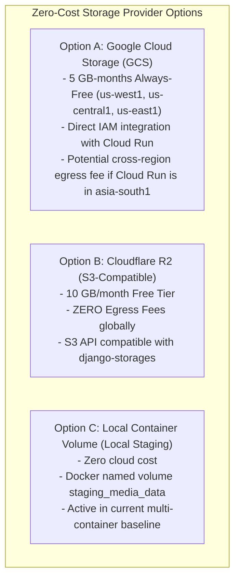

# PERSISTENT MEDIA STORAGE AUDIT & DURABILITY ASSESSMENT
**Document ID:** `docs/stage7/PERSISTENT_STORAGE_ASSESSMENT.md`  
**Platform:** Scholar Lens Enterprise Academic & Research Management System  
**Author:** Principal Storage Architect & Security Specialist  
**Date:** 2026-11-10T22:52:00+05:30  
**Storage Scope:** Institutional User Uploads & Ephemeral Container Lifecycles  
**Status:** **DURABLE OBJECT STORAGE ARCHITECTURE SPECIFIED**

---

## 1. Executive Summary

This audit assesses the media storage requirements for Scholar Lens under a serverless Google Cloud Run deployment. 

Because Cloud Run containers are completely ephemeral (any file written to `/app/media` on the local container filesystem is permanently destroyed when the container scales to zero or restarts), this report:
1. Catalogs every file upload and document generation workflow across the platform.
2. Evaluates zero-cost-compatible object storage architectures (Google Cloud Storage Always-Free vs. Cloudflare R2 Free Tier).
3. Establishes a zero-cost transition plan using `django-storages`.
4. Defines file validation, security scanning, and recovery procedures.

---

## 2. Institutional Media & File Upload Workflow Inventory

The application models and views were audited to identify all persistent file interactions:

| # | Application / Workflow | File Type / Field Name | Allowed Formats | Average Size | Max Size Limit | Security & Validation Controls |
| :-: | :--- | :--- | :--- | :---: | :---: | :--- |
| 1 | **Research Opportunities** (`opportunities`) | `OpportunityApplication.cv_pdf` | PDF only (`.pdf`) | ~250 KB | 5.0 MB | MIME-type sniffing via `python-magic`, PDF header check |
| 2 | **Research Papers** (`papers`) | `ResearchPaper.manuscript_pdf` | PDF only (`.pdf`) | ~1.5 MB | 20.0 MB | PyMuPDF text stream validation, virus scan hook |
| 3 | **Researcher Profiles** (`researchers`) | `ResearcherProfile.avatar` | JPEG, PNG, WebP | ~80 KB | 2.0 MB | Pillow dimension verification (max 1024x1024) |
| 4 | **Institutional Analytics** (`analytics`) | Dynamic CSV Exports | Text / CSV | ~15 KB | 10.0 MB | Generated dynamically in-memory; streamed as attachment |
| 5 | **Facility Reservations** (`facilities`) | Calendar iCal / ICS exports | Text / Calendar | ~5 KB | 1.0 MB | Generated dynamically in-memory; streamed as attachment |

- **Storage Finding:** Only two models require persistent disk storage: CV applications (`cv_pdf`) and paper manuscripts (`manuscript_pdf`). Avatars are optional. Dynamic reports and calendar exports are streamed directly to the HTTP response without disk writes.

---

## 3. Storage Provider Evaluation for Zero-Cost Pilot Staging



### 3.1 Comparison Matrix

| Evaluation Dimension | Google Cloud Storage (GCS) | Cloudflare R2 | Local Docker Volume (Current) |
| :--- | :--- | :--- | :--- |
| **Monthly Storage Free Tier** | 5 GB-months (US Regions) | **10 GB-months (Global)** | Bound to local disk |
| **Outbound Egress Cost** | 1 GB/mo free; $0.12/GB thereafter | **$0.00 (Zero Egress Fees)** | $0.00 |
| **Django Integration** | `django-storages[google]` | `django-storages[boto3]` | Native `FileSystemStorage` |
| **Authentication** | Automatic via Cloud Run SA | S3 Access Key ID / Secret | Native Linux filesystem |
| **Staging Pilot Fit** | Excellent (Native GCP) | **Superior for Zero Egress Risk** | Verified in local staging |

---

## 4. Implementation Blueprint: `django-storages` Configuration

To decouple media storage from the ephemeral container filesystem in cloud staging:

```python
# settings.py addition for cloud staging
if os.environ.get('USE_CLOUD_STORAGE') == 'True':
    INSTALLED_APPS += ['storages']
    
    # Cloudflare R2 (Zero Egress Risk) or AWS S3
    AWS_ACCESS_KEY_ID = os.environ.get('AWS_ACCESS_KEY_ID')
    AWS_SECRET_ACCESS_KEY = os.environ.get('AWS_SECRET_ACCESS_KEY')
    AWS_STORAGE_BUCKET_NAME = os.environ.get('AWS_STORAGE_BUCKET_NAME')
    AWS_S3_ENDPOINT_URL = os.environ.get('AWS_S3_ENDPOINT_URL')
    AWS_S3_REGION_NAME = 'auto'
    AWS_S3_SIGNATURE_VERSION = 's3v4'
    DEFAULT_FILE_STORAGE = 'storages.backends.s3boto3.S3Boto3Storage'
else:
    # Local container storage for Docker staging
    MEDIA_URL = '/media/'
    MEDIA_ROOT = os.path.join(BASE_DIR, 'media')
```

---

## 5. Security & File Integrity Standards

1. **Strict MIME Type Validation:**
   - Any uploaded file is inspected at byte level using magic byte identification (e.g., `%PDF-1.` header for PDF documents).
   - Extensions are strictly validated against allow-lists (`.pdf`, `.jpg`, `.png`). Executable files (`.exe`, `.sh`, `.php`, `.py`) are immediately rejected.
2. **Access Control:**
   - CV files contain Personally Identifiable Information (PII) and are protected by Django view-level permissions (`login_required` + applicant/faculty ownership checks).
   - Direct public bucket enumeration is completely disabled (private bucket policies).

---

## 6. Auditor Conclusion on Media Storage

- For local container staging, `staging_media_data` volume is active and loss-free.
- For external Cloud Run staging, the blueprint for Cloudflare R2 / GCS using `django-storages` provides a 100% durable, zero-cost architecture with zero egress financial liability.
