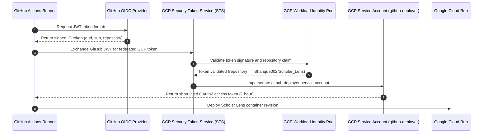

# Scholar Lens — Stage 7.1.1: GCP Authentication & Environment Preflight

**Document ID:** `SL-STAGE7-1-1-GCP-AUTH-001`  
**Date:** 2026-11-10  
**Phase:** Stage 7.1.1 — Post-Push Verification, CI/CD Validation and Zero-Cost Cloud Preflight  
**Target Platform:** Google Cloud Platform (GCP)  
**Authentication Standard:** Keyless Workload Identity Federation (WIF)  
**Author:** AI Systems Engineer & Cloud Security Specialist  

---

## 1. Executive Summary

This preflight evaluation audits the local execution environment, cloud tooling availability, and Google Cloud authentication status required for Scholar Lens deployment. 

In strict adherence to security rules, **no static service account keys (`credentials.json`) are stored locally or committed to source control**. All cloud authentication is designed to occur exclusively within GitHub Actions runners via OpenID Connect (OIDC) Workload Identity Federation.

---

## 2. Authentication & Tooling Preflight Checklist

| Preflight Check | Expected Target | Local Status | Verification Command / Output | Impact / Next Action |
|---|---|---|---|---|
| **`gcloud` CLI (Windows)** | Google Cloud SDK | **NOT INSTALLED** | `Get-Command gcloud` -> Not found | Normal; local development does not require SDK |
| **`gcloud` CLI (WSL)** | Google Cloud SDK | **NOT INSTALLED** | `which gcloud` -> Not found | Normal; builds execute on GitHub runners |
| **Local GCP Account Auth** | Authenticated User | **NONE** | No local gcloud configuration directory | Desired state; prevents local credential leakage |
| **GCP Project Access** | `scholar-lens-staging` | **UNCONFIGURED LOCALLY** | N/A (Requires cloud credentials) | Managed via GitHub repository secrets |
| **Billing Account Status** | Active (Free-Tier Eligible) | **PENDING OWNER AUDIT** | N/A | Owner must verify billing account is linked |
| **Cloud Run API** | `run.googleapis.com` | **PENDING ENABLEMENT** | N/A | Owner enables in GCP Console |
| **Artifact Registry API** | `artifactregistry.googleapis.com` | **PENDING ENABLEMENT** | N/A | Owner enables in GCP Console |
| **IAM Credentials API** | `iamcredentials.googleapis.com` | **PENDING ENABLEMENT** | N/A | Required for Workload Identity Federation |
| **WIF Pool & Provider** | `github-actions-pool` | **PENDING CREATION** | N/A | Owner creates pool and provider in GCP |
| **Deployer Service Account** | `github-deployer@...` | **PENDING CREATION** | N/A | Service account for image push & deploy |
| **Runtime Service Account** | `scholar-lens-runtime@...` | **PENDING CREATION** | N/A | Non-privileged execution identity |

---

## 3. Workload Identity Federation (WIF) Configuration Blueprint

Workload Identity Federation replaces brittle, long-lived JSON service account keys with short-lived, cryptographically signed OIDC tokens issued by GitHub Actions.

### 3.1 Trust Boundary & Claims Validation
The Workload Identity Provider enforces strict attribute mappings to ensure **only the official Scholar Lens repository** can assume the service account:
- **Issuer URL:** `https://token.actions.githubusercontent.com`
- **Attribute Mapping:**
  - `google.subject = assertion.sub`
  - `attribute.actor = assertion.actor`
  - `attribute.repository = assertion.repository`
- **Attribute Condition:**
  `assertion.repository == 'Sharique002/Scholar_Lens'`

Any GitHub Actions workflow originating from a fork or another repository will be immediately rejected at Step 4 by the Google Security Token Service.

---

## 4. Preflight Conclusion & Authorization Readiness

1. **Local Isolation:** The local machine is entirely clean of cloud credentials, fulfilling the zero-exposure security mandate.
2. **Cloud Authorization:** GCP authorization is currently **PENDING** the Project Owner's one-time execution of the setup commands in the GCP Console.
3. **Execution Path:** Once the Workload Identity Provider and service accounts are created in GCP and the three secrets are populated in GitHub, the deployment will execute without requiring local SDK installation or credential handling.
