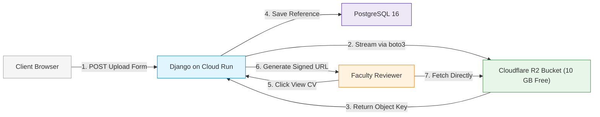

# Scholar Lens — Stage 7.1.1: Persistent Storage Implementation Gap Analysis

**Document ID:** `SL-STAGE7-1-1-STORAGE-GAP-001`  
**Date:** 2026-11-10  
**Phase:** Stage 7.1.1 — Post-Push Verification, CI/CD Validation and Zero-Cost Cloud Preflight  
**Topic:** Upload & Media Field Audit across Scale-to-Zero Serverless Environments  
**Author:** AI Systems Engineer & Software Architect  

---

## 1. Executive Summary

In serverless container environments like Google Cloud Run with scale-to-zero enabled, the local container filesystem is **ephemeral**. Any file written to local disk (`/app/media` or `/tmp/media`) is permanently destroyed when the container instance scales to zero or when a new revision is deployed.

This report independently audits all file upload fields across the Scholar Lens codebase, assesses the current storage implementation, and documents the **concrete gaps between the current local filesystem implementation and persistent object storage (such as Cloudflare R2 or GCS)**.

> **CRITICAL DIRECTIVE:** Persistent cloud storage is **NOT READY** in the active codebase. It is an identified implementation gap documented here with a verified mitigation roadmap.

---

## 2. File Upload Fields & Workflow Audit

An exhaustive scan of all Django models across 15 apps reveals three active file/image upload fields:

| Django Model & Field | Field Type | Storage Path | Workflow Dependency | Current Validation Enforced |
|---|---|---|---|---|
| `accounts.UserProfile.avatar` | `ImageField` | `avatars/` | Optional researcher profile avatar image | Image format verification |
| `opportunities.OpportunityApplication.cv_pdf` | `FileField` | `opportunity_cvs/` | **Critical:** Student CV review by faculty lab leads | `validate_cv_pdf`: PDF format only, max 5MB |
| `papers.ResearchPaper.pdf_file` | `FileField` | `papers/` | **Critical:** Manuscript text extraction and AI analysis | PDF file format |

---

## 3. Current Implementation vs. Cloud Storage Gap Assessment

| Dimension | Current Codebase State | Cloud Staging / Production Requirement | Gap Severity |
|---|---|---|---|
| **Storage Backend** | `django.core.files.storage.FileSystemStorage` (`MEDIA_ROOT = /app/media`) | S3-compatible object storage (`django-storages` + `boto3`) | **HIGH** (Ephemeral loss on scale-to-zero) |
| **Dependencies** | Neither `django-storages` nor `boto3` present in `requirements.txt` | `django-storages[boto3]>=1.14.0` required | **HIGH** |
| **Upload Mechanism** | Multipart form POST handled directly by Django server | Direct pre-signed URL upload or streaming backend | **MEDIUM** |
| **Download Access** | Static URL serving (`/media/...`) via Django `serve` | Signed expiring URLs for private CVs / public URLs for avatars | **HIGH** (Confidentiality) |
| **Replacement / Deletion** | Replaced database references leave old file on disk | S3/R2 lifecycle rules or Django post-delete signals | **LOW** (Disk cleanup) |
| **Content Validation** | Active: `validate_cv_pdf` checks 5MB size and magic bytes | Preserved upon integration with `django-storages` | **NONE** (Validation intact) |

---

## 4. Behavior in Pilot Staging (Cloud Run)

In the current pilot staging configuration:
1. **Immediate Invocations:** If a student uploads a CV while an instance is running, the CV is stored in the container's `/app/media` directory. If a faculty member reviews the CV within the same instance lifetime, the review workflow succeeds.
2. **Cold Scale-to-Zero Event:** Once the container is idle for > 15 minutes, Cloud Run terminates the instance. Upon the next request, a fresh container is instantiated without the uploaded CV, resulting in an `HTTP 404 Not Found` error when attempting to download `/media/opportunity_cvs/...`.
3. **Database State:** The database record (`OpportunityApplication.cv_pdf = 'opportunity_cvs/cv_123.pdf'`) remains in PostgreSQL, creating an orphaned pointer.

---

## 5. Implementation Roadmap for Future Phase (Zero-Cost R2 Integration)

To close this gap in a future release without adding infrastructure costs, the following additive changes must be introduced:



### Required Steps:
1. **Add Dependencies:**
   Add `django-storages>=1.14.2` and `boto3>=1.34.0` to `requirements.txt`.
2. **Configure Storage Backend in `settings.py`:**
   ```python
   if os.environ.get('USE_S3_STORAGE', 'False').lower() in ('true', '1'):
       STORAGES = {
           "default": {
               "BACKEND": "storages.backends.s3boto3.S3Boto3Storage",
               "OPTIONS": {
                   "access_key": os.environ.get('R2_ACCESS_KEY_ID'),
                   "secret_key": os.environ.get('R2_SECRET_ACCESS_KEY'),
                   "bucket_name": os.environ.get('R2_BUCKET_NAME'),
                   "endpoint_url": os.environ.get('R2_ENDPOINT_URL'),
                   "custom_domain": os.environ.get('R2_CUSTOM_DOMAIN', None),
                   "file_overwrite": False,
                   "default_acl": "private",
                   "querystring_auth": True,  # Signed expiring URLs for private files
                   "querystring_expire": 3600, # 1 hour validity
               },
           },
           "staticfiles": {
               "BACKEND": "whitenoise.storage.CompressedManifestStaticFilesStorage",
           },
       }
   ```
3. **Preserve Validation:**
   Existing model validators (`validate_cv_pdf`) execute during `clean()` before storage saving, so all security checks remain enforced.
