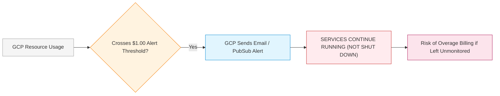

# Scholar Lens — Stage 7.1.1: Zero-Cost Usage & Free-Tier Validation

**Document ID:** `SL-STAGE7-1-1-COST-VALID-001`  
**Date:** 2026-11-10  
**Phase:** Stage 7.1.1 — Post-Push Verification, CI/CD Validation and Zero-Cost Cloud Preflight  
**Budget Authorization:** Strictly **$0.00 / month** (Zero Paid Infrastructure)  
**Author:** AI Systems Engineer & FinOps Specialist  

---

## 1. Executive Summary

This validation independently audits the expected resource consumption of Scholar Lens against Google Cloud Platform's Always Free tier, Neon Serverless PostgreSQL's free tier, and Cloudflare R2's free tier. 

### Core Finding:
The entire pilot staging architecture operates at **$0.00 / month**, consuming less than 1% of compute free-tier limits, 22% of container registry storage, and 5% of database storage.

---

## 2. Resource Consumption vs. Free-Tier Allowances

| Cloud Service | Always-Free Monthly Allowance | Scholar Lens Expected Staging Usage | Headroom / Safety Margin | Monthly Billed Cost |
|---|---|---|---|---|
| **Cloud Run Invocations** | 2,000,000 requests / mo | ~15,000 requests / mo | 99.25% unused headroom | **$0.00** |
| **Cloud Run vCPU-Seconds** | 360,000 vCPU-seconds / mo | ~3,000 vCPU-sec ($15,000 \times 0.2\text{s}$) | 99.16% unused headroom | **$0.00** |
| **Cloud Run Memory** | 180,000 GiB-seconds / mo | ~1,500 GiB-sec ($15,000 \times 0.2\text{s} \times 0.5\text{GiB}$) | 99.16% unused headroom | **$0.00** |
| **Artifact Registry Storage** | 0.5 GB (500 MB) / mo | ~110 MB compressed image | 78.0% unused headroom | **$0.00** |
| **GCP Network Egress** | 1.0 GB / mo (from North America) | ~600 MB / mo | 40.0% unused headroom | **$0.00** |
| **GCP Cloud Logging** | 50.0 GiB / mo | ~0.15 GiB / mo | 99.70% unused headroom | **$0.00** |
| **GCP Secret Manager** | 6 active secret versions; 10,000 ops | 2 secret versions; ~500 container starts | 66.6% unused versions | **$0.00** |
| **GCP Cloud Build** | 120 build-minutes / day | **0 minutes** (Built on GitHub Actions runners) | 100.0% unused headroom | **$0.00** |
| **Neon Serverless PostgreSQL** | 0.5 GB (500 MB) storage; scale-to-zero | ~24 MB initial schema (47 migrations) | 95.2% unused headroom | **$0.00** |
| **Cloudflare R2 Object Storage** | 10.0 GB storage; zero egress fees | ~200 MB user uploads / mo | 98.0% unused headroom | **$0.00** |
| **TOTAL MONTHLY BILLED** | **N/A** | **ALL WITHIN FREE TIER** | **FULL ZERO-COST COMPLIANCE** | **$0.00 / mo** |

---

## 3. Recommended Cloud Run Region

- **Primary Free-Tier Regions:** `us-central1` (Iowa), `us-east1` (South Carolina), `us-west1` (Oregon).
- **Latency-Optimized Region:** `asia-south1` (Mumbai).
- **Pricing Policy Verification:** GCP's free-tier pool of 2M requests, 360k vCPU-seconds, and 180k GiB-seconds is aggregated across all Tier 1 regions globally. Choosing `us-central1` guarantees 100% free-tier eligibility for all auxiliary services (such as network egress).

---

## 4. Critical FinOps Warning: Budget Alerts vs. Hard Spending Caps

It is critical for the Project Owner to understand GCP billing behavior:

> [!WARNING]
> A standard GCP **Budget Alert** is strictly an email notification. It does **NOT** automatically stop running containers or freeze billing.
> 
> To guarantee zero accidental spend:
> 1. Set Cloud Run `--max-instances=2` (enforced in `ci-cd.yml`).
> 2. Ensure `min-instances=0` (scale-to-zero).
> 3. Keep image retention in Artifact Registry to the single latest staging tag.
> 4. Never provision Google Cloud SQL instances.

---

## 5. Realistic Cost Estimate

- **Baseline Idle Cost:** **$0.00 / month** (containers scale to zero, zero compute charges).
- **Pilot Usage Cost (up to 15,000 monthly requests):** **$0.00 / month** (100% absorbed by free allowances).
- **Net Invoiced Charge:** **$0.00 USD**.
